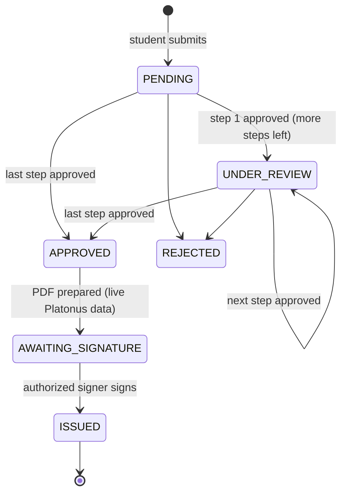

# Approval workflow

## Request statuses

Document statuses: `AWAITING_SIGNATURE` → `ISSUED` → (`REVOKED`). Expiry is computed from `valid_until` (default `CERTIFICATE_VALIDITY_DAYS=90`).

## Default chain

| # | Step | Role |
| --- | --- | --- |
| 1 | Enrollment verification | SPECIALIST |
| 2 | Financial check | ACCOUNTANT |
| 3 | Final approval | AUTHORIZED_SIGNER |

After step 3 the system prepares the PDF and the authorized signer signs it. The official AHEU process may differ, so the chain is configurable.

## Configuration

Admin dashboard → *Approval chain*, or `PUT /api/admin/workflow`.

- A **default chain** plus optional **overrides per certificate type** (e.g. a visa letter without the financial check).
- 1–6 steps; roles: SPECIALIST, ACCOUNTANT, AUTHORIZED_SIGNER. The **last step must be AUTHORIZED_SIGNER**.
- Each request stores a snapshot of its chain at submission, so changing the configuration never breaks requests that are already in progress.
- Every change is audited.

## Rules enforced by the API

Implemented in `apps/api/src/workflow/workflow-rules.ts` (pure functions, unit-tested) and applied inside a database transaction:

1. Only requests in `PENDING` / `UNDER_REVIEW` can be decided.
2. Only a user with the **role of the current step** can approve or reject it. Accountants cannot skip ahead; administrators are not part of the chain.
3. **Separation of duties**: one person cannot approve two steps of the same request.
4. Nobody can decide their own request.
5. Concurrent decisions are safe: the update only succeeds if the request is still at the same status and step, and the database allows one decision per step.
6. Rejection requires a reason, which the student sees.
7. Every approval, rejection, preparation, signature, download and revocation is written to `audit_logs`.

AI tools are not part of this process: approvals, signing and revocation are always explicit human actions.
