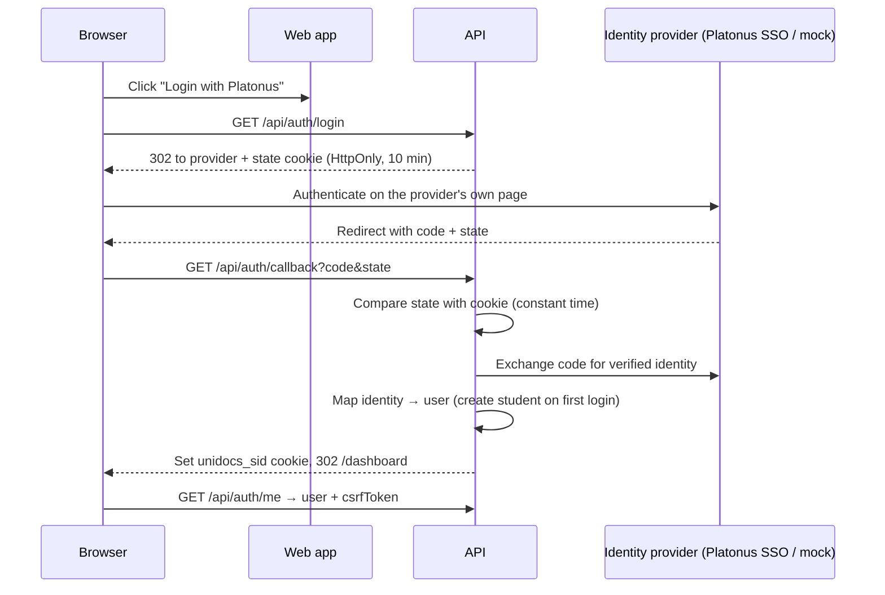

# Authentication

## Principles

- Students log in with their **existing Platonus account**. UniDocs has no student passwords.
- UniDocs **never collects, stores or proxies** Platonus passwords, never scrapes Platonus login pages and never calls undocumented endpoints.
- Staff accounts are **provisioned by a system administrator**; nobody becomes staff by logging in.
- Sessions are server-side; the browser only holds a random token in an HttpOnly cookie.

## Flow

## Mapping identities to users

`users (auth_provider, external_user_id)` is unique. For students `external_user_id` is the Platonus student ID, which is also the key used with the `StudentDataProvider`.

| Situation | Result |
| --- | --- |
| Known, active user | Logged in |
| Known, deactivated user | Denied |
| Unknown student, found by `StudentDataProvider` | User created with role `STUDENT` (audited) |
| Unknown student, not found | Denied |
| Unknown staff identity | Denied: must be provisioned in the admin dashboard |

## Sessions and CSRF

- Cookie `unidocs_sid`: 32 random bytes, `HttpOnly`, `SameSite=Lax`, `Secure` when `COOKIE_SECURE=true`, lifetime `SESSION_TTL_HOURS` (default 8).
- The database stores only the SHA-256 of the token. Logout deletes the session row; deactivating a user deletes all of their sessions.
- Each session has its own CSRF token. The web app reads it from `GET /api/auth/me` and sends it as `X-CSRF-Token` on every state-changing request.
- Login and callback are rate-limited (20/min per IP).

## Development: mock provider

With `AUTH_PROVIDER=mock`, `/api/auth/login` redirects to `/dev/mock-login`, a page with a clear "DEVELOPMENT MODE — not Platonus" banner listing **fictional** identities:

| ID | Role | Notes |
| --- | --- | --- |
| `PL-100001` … `PL-100003` | Student | ACTIVE |
| `PL-100004` | Student | ACADEMIC_LEAVE (cannot request certificates) |
| `PL-100005` | Student | GRADUATED (graduation certificate only) |
| `staff-specialist` | SPECIALIST | seeded |
| `staff-accountant` | ACCOUNTANT | seeded |
| `staff-signer` | AUTHORIZED_SIGNER | seeded |
| `staff-admin` | SYSTEM_ADMIN | seeded |

The identity list endpoint returns 404 outside `mock` mode, and the API refuses to start in production with the mock provider.

## Replacing the mock with Platonus SSO

Implementation lives in `apps/api/src/auth/providers/platonus-sso.provider.ts`. Steps once AHEU provides the official documentation:

1. Confirm the protocol (OAuth 2.0 / OpenID Connect / SAML) and register UniDocs as a client. Fill `PLATONUS_SSO_*` variables.
2. `buildAuthorizationUrl(state)`: build the documented authorization URL with `client_id`, `redirect_uri` (= `https://<host>/api/auth/callback`) and `state`. Use PKCE if supported.
3. `handleCallback(code)`: exchange the code **server-side**, validate the token/assertion signature, issuer, audience and expiry, and read the documented student ID claim. Return `{ provider: "platonus", externalUserId, kind: "student", email }`.
4. Decide how staff authenticate (university IdP or Platonus staff accounts) and set `kind: "staff"` accordingly; staff still have to be provisioned.
5. Set `AUTH_PROVIDER=platonus`, add tests with recorded (fictional) responses, and test against the university's test environment before production.
