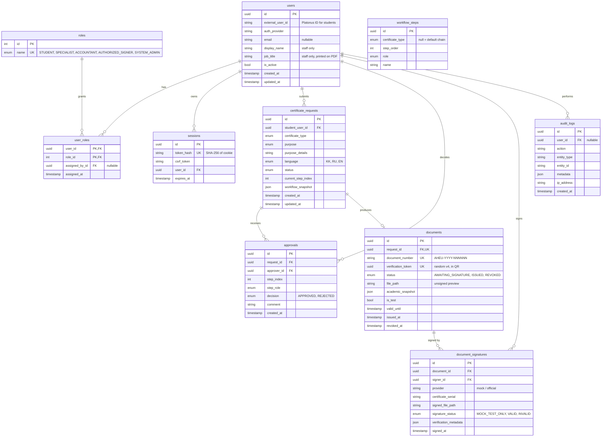

# Database

> Full specification (attribute tables, cardinality, cascade rules, 3NF and indexing justification): [database-schema.md](database-schema.md). Crow's Foot diagram: [erd.pdf](erd.pdf).

PostgreSQL, managed with Prisma 7. Schema: [`apps/api/prisma/schema.prisma`](../apps/api/prisma/schema.prisma). Migrations: [`apps/api/prisma/migrations`](../apps/api/prisma/migrations).

**Student academic data is not stored.** Platonus is the source of truth; the API reads it live through the `StudentDataProvider`. The only copy is `documents.academic_snapshot`, frozen when a document is prepared, so an issued certificate keeps the data it was issued with.

## ER diagram



## Constraints and indexes

| Table | Constraint | Why |
| --- | --- | --- |
| `users` | unique `(auth_provider, external_user_id)` | Stable mapping between our user ID and the Platonus ID |
| `user_roles` | primary key `(user_id, role_id)` | No duplicate role grants |
| `sessions` | unique `token_hash`; index `expires_at` | Fast lookup, cleanup |
| `approvals` | unique `(request_id, step_index)` | One decision per workflow step |
| `documents` | unique `request_id`, `document_number`, `verification_token` | One document per request; QR tokens never repeat |
| `certificate_requests` | index `(student_user_id, created_at)`, `status` | Student lists, staff queues |
| `audit_logs` | index `created_at`, `(entity_type, entity_id)`, `user_id` | Audit search |

The sequence `document_number_seq` (created in the init migration) issues document numbers.

Foreign keys use `RESTRICT` for records that must never disappear (requests, approvals, documents, signatures) and `SET NULL` for optional actor references in audit logs.

## Commands

```bash
npm run db:up                         # start PostgreSQL (docker compose)
npm run db:migrate                    # apply migrations (prisma migrate deploy)
npm run db:migrate:dev -w apps/api    # create a new migration after editing schema.prisma
npm run db:seed                       # roles, default workflow, fictional staff
```
