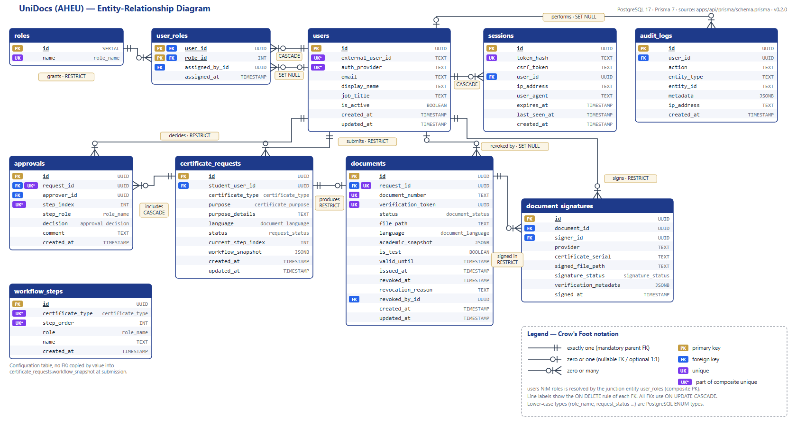

# UniDocs — Database Schema Specification & Architectural Justification

**Course:** PED 741 Software Development Practice · **Deliverable 2:** ERD, Relational Schema & Architectural Justification
**Application:** UniDocs — AHEU (Almaty Humanitarian-Economic University) Certificate Management System
**Release:** `v0.2.0` · **DBMS:** PostgreSQL 17 · **ORM:** Prisma 7

| Artifact | Location |
| --- | --- |
| Visual ERD (Crow's Foot) | [`docs/erd.pdf`](erd.pdf) · [`docs/erd.png`](erd.png) · editable source [`docs/erd.svg`](erd.svg) |
| Entity tables, relationships, justification | this file |
| Executable ORM schema | [`apps/api/prisma/schema.prisma`](../apps/api/prisma/schema.prisma) |
| Generated SQL (DDL) | [`apps/api/prisma/migrations/20261101123000_init/migration.sql`](../apps/api/prisma/migrations/20261101123000_init/migration.sql) |

> **Repository layout note.** The project is an npm-workspaces monorepo (`apps/api` = backend, `apps/web` = frontend), so the Prisma schema lives in `apps/api/prisma/` instead of a root `prisma/` folder. Everything in this document is derived from that schema and its migration.

---

## Contents

1. [Domain overview](#1-domain-overview)
2. [Entity-Relationship Diagram](#2-entity-relationship-diagram)
3. [Domain types (PostgreSQL ENUMs)](#3-domain-types-postgresql-enums)
4. [Entity & attribute tables](#4-entity--attribute-tables)
5. [Relationships, cardinality & referential integrity](#5-relationships-cardinality--referential-integrity)
6. [Business rules enforced by the schema](#6-business-rules-enforced-by-the-schema)
7. [Architectural justification](#7-architectural-justification)
8. [Known limitations & planned improvements](#8-known-limitations--planned-improvements)
9. [Database setup](#9-database-setup)

---

## 1. Domain overview

Students request official certificates (enrollment certificate, visa support letter, …). Each request passes a **configurable multi-step approval chain** (Specialist → Accountant → Authorized signer by default). After the last approval the system generates a PDF with a unique QR code; the authorized signer signs it; anyone can verify the certificate publicly by scanning the QR code.

Two external systems shape the design:

- **Platonus** (the university's student information system) is the *source of truth* for student academic data (name, faculty, course, status). UniDocs **does not copy the student database**; it reads it on demand. Only a frozen snapshot is stored on each issued document.
- **Kazakhstan EDS (NCALayer / NCA RK)** produces digital signatures; UniDocs stores signature artifacts and verification metadata.

The schema has **10 tables** grouped by concern:

| Concern | Tables |
| --- | --- |
| Identity & access | `users`, `roles`, `user_roles` (junction), `sessions` |
| Workflow configuration | `workflow_steps` |
| Core workflow | `certificate_requests`, `approvals` |
| Issued documents | `documents`, `document_signatures` |
| Compliance | `audit_logs` |

---

## 2. Entity-Relationship Diagram



Notation: Crow's Foot. `‖` exactly one · `o|` zero or one · `o<` zero or many. Badges: **PK** primary key, **FK** foreign key, **UK** unique, **UK\*** member of a composite unique key. Each relationship line is labelled with its `ON DELETE` rule. The full-resolution version is [`erd.pdf`](erd.pdf).

---

## 3. Domain types (PostgreSQL ENUMs)

Enumerated domains are implemented as native PostgreSQL `ENUM` types. They act as **domain constraints**: the database rejects any value outside the list, which is equivalent to a `CHECK (col IN (...))` constraint but reusable across tables.

| ENUM type | Allowed values | Used by |
| --- | --- | --- |
| `role_name` (`"RoleName"`) | `STUDENT`, `SPECIALIST`, `ACCOUNTANT`, `AUTHORIZED_SIGNER`, `SYSTEM_ADMIN` | `roles.name`, `workflow_steps.role`, `approvals.step_role` |
| `certificate_type` | `ENROLLMENT_CERTIFICATE`, `STUDENT_STATUS_LETTER`, `INTERNSHIP_CONFIRMATION`, `TRANSCRIPT_REQUEST`, `VISA_SUPPORT_LETTER`, `GRADUATION_CONFIRMATION` | `certificate_requests`, `workflow_steps` |
| `certificate_purpose` | `EMPLOYMENT`, `INTERNSHIP`, `VISA_APPLICATION`, `SCHOLARSHIP`, `BANK`, `OTHER` | `certificate_requests.purpose` |
| `document_language` | `KK`, `RU`, `EN` | `certificate_requests.language`, `documents.language` |
| `request_status` | `PENDING`, `UNDER_REVIEW`, `APPROVED`, `REJECTED`, `AWAITING_SIGNATURE`, `ISSUED` | `certificate_requests.status` |
| `approval_decision` | `APPROVED`, `REJECTED` | `approvals.decision` |
| `document_status` | `AWAITING_SIGNATURE`, `ISSUED`, `REVOKED` | `documents.status` |
| `signature_status` | `MOCK_TEST_ONLY`, `VALID`, `INVALID` | `document_signatures.signature_status` |

A database **sequence** `document_number_seq` generates the human-readable document numbers `AHEU-YYYY-NNNNNN`.

---

## 4. Entity & attribute tables

Conventions used in every table:

- **Primary keys** are `UUID` (generated by the application with `uuid()`), except `roles.id` (`SERIAL`), a tiny lookup table.
- **Strings** are `TEXT`. In PostgreSQL `TEXT` and `VARCHAR(n)` have identical storage and performance; maximum lengths are business rules validated by the API (column *Validation* below) so they can change without a table rewrite.
- **Timestamps** are `TIMESTAMP(3)` (millisecond precision), always written in UTC by the application.
- *Validation* lists rules enforced in the API layer (class-validator DTOs) in addition to the database constraints.

### 4.1 `users`

Every person who can log in: students (created on first Platonus login) and staff (provisioned by an administrator). Student academic data is **not** stored here.

| Column | SQL type | Constraints | Description |
| --- | --- | --- | --- |
| `id` | `UUID` | **PK**, NOT NULL | Internal user identifier |
| `external_user_id` | `TEXT` | NOT NULL, **UNIQUE** (`auth_provider`, `external_user_id`) | ID in the identity provider; for students the Platonus student ID (e.g. `PL-100001`) |
| `auth_provider` | `TEXT` | NOT NULL, part of composite UNIQUE | Identity provider: `platonus`, `mock` (development) |
| `email` | `TEXT` | NULL | Contact e-mail (validated as e-mail, ≤ 200) |
| `display_name` | `TEXT` | NULL | Staff only: full name printed under signatures (2–150 chars). NULL for students — their name comes from Platonus |
| `job_title` | `TEXT` | NULL | Staff only: designation printed on PDFs and the public verification page |
| `is_active` | `BOOLEAN` | NOT NULL, DEFAULT `true` | Soft deactivation; inactive users cannot log in. Users are deactivated, never deleted |
| `created_at` | `TIMESTAMP(3)` | NOT NULL, DEFAULT `CURRENT_TIMESTAMP` | Creation time |
| `updated_at` | `TIMESTAMP(3)` | NOT NULL | Last update (maintained by Prisma) |

### 4.2 `roles`

Lookup table of the five application roles.

| Column | SQL type | Constraints | Description |
| --- | --- | --- | --- |
| `id` | `INTEGER` (`SERIAL`) | **PK**, NOT NULL | Surrogate key |
| `name` | `role_name` ENUM | NOT NULL, **UNIQUE** | Role name |

### 4.3 `user_roles` — junction entity (users N:M roles)

A user can hold several roles (e.g. Specialist + Accountant) and a role is held by many users.

| Column | SQL type | Constraints | Description |
| --- | --- | --- | --- |
| `user_id` | `UUID` | **PK** (composite), **FK** → `users.id` ON DELETE CASCADE, NOT NULL | Grantee |
| `role_id` | `INTEGER` | **PK** (composite), **FK** → `roles.id` ON DELETE RESTRICT, NOT NULL, INDEX | Granted role |
| `assigned_by_id` | `UUID` | **FK** → `users.id` ON DELETE SET NULL, NULL | Administrator who granted the role (NULL for seeded/initial grants) |
| `assigned_at` | `TIMESTAMP(3)` | NOT NULL, DEFAULT `CURRENT_TIMESTAMP` | Grant time |

Composite **PK (`user_id`, `role_id`)** makes a duplicate grant impossible.

### 4.4 `sessions`

Server-side login sessions. The browser holds only a random token in an HttpOnly cookie.

| Column | SQL type | Constraints | Description |
| --- | --- | --- | --- |
| `id` | `UUID` | **PK**, NOT NULL | Session identifier |
| `token_hash` | `TEXT` | NOT NULL, **UNIQUE** | SHA-256 of the cookie token; the raw token is never stored |
| `csrf_token` | `TEXT` | NOT NULL | Per-session anti-CSRF token |
| `user_id` | `UUID` | **FK** → `users.id` ON DELETE CASCADE, NOT NULL, INDEX | Session owner |
| `ip_address` | `TEXT` | NULL | Client IP at login |
| `user_agent` | `TEXT` | NULL | Browser user agent (truncated to 300 chars) |
| `expires_at` | `TIMESTAMP(3)` | NOT NULL, INDEX | Absolute expiry (`SESSION_TTL_HOURS`, default 8 h) |
| `last_seen_at` | `TIMESTAMP(3)` | NOT NULL, DEFAULT `CURRENT_TIMESTAMP` | Last activity (refreshed at most every 5 min) |
| `created_at` | `TIMESTAMP(3)` | NOT NULL, DEFAULT `CURRENT_TIMESTAMP` | Login time |

### 4.5 `workflow_steps`

Configurable approval chain. Rows with `certificate_type = NULL` form the **default** chain; rows with a type form an override for that certificate type.

| Column | SQL type | Constraints | Description |
| --- | --- | --- | --- |
| `id` | `UUID` | **PK**, NOT NULL | Step identifier |
| `certificate_type` | `certificate_type` ENUM | NULL, part of **UNIQUE** (`certificate_type`, `step_order`) | NULL = default chain |
| `step_order` | `INTEGER` | NOT NULL, part of composite UNIQUE | 0-based position in the chain (max 6 steps) |
| `role` | `role_name` ENUM | NOT NULL | Role that decides this step (API allows `SPECIALIST`, `ACCOUNTANT`, `AUTHORIZED_SIGNER`; last step must be `AUTHORIZED_SIGNER`) |
| `name` | `TEXT` | NOT NULL | Step label or translation key, e.g. `ENROLLMENT_VERIFICATION` (2–80 chars) |
| `created_at` | `TIMESTAMP(3)` | NOT NULL, DEFAULT `CURRENT_TIMESTAMP` | Creation time |

### 4.6 `certificate_requests`

A student's request for a certificate and its position in the approval workflow.

| Column | SQL type | Constraints | Description |
| --- | --- | --- | --- |
| `id` | `UUID` | **PK**, NOT NULL | Request identifier |
| `student_user_id` | `UUID` | **FK** → `users.id` ON DELETE RESTRICT, NOT NULL, INDEX (`student_user_id`, `created_at`) | Requesting student |
| `certificate_type` | `certificate_type` ENUM | NOT NULL | Requested certificate |
| `purpose` | `certificate_purpose` ENUM | NOT NULL | Where the certificate will be used |
| `purpose_details` | `TEXT` | NULL | Free text, e.g. bank name (≤ 200 chars, no control characters) |
| `language` | `document_language` ENUM | NOT NULL, DEFAULT `'KK'` | Language of the certificate |
| `status` | `request_status` ENUM | NOT NULL, DEFAULT `'PENDING'`, INDEX | Workflow state |
| `current_step_index` | `INTEGER` | NOT NULL, DEFAULT `0` | Index of the step awaiting a decision (= number of steps once approved) |
| `workflow_snapshot` | `JSONB` | NOT NULL | Immutable copy of the approval chain at submission time: `[{"role": …, "name": …}]` |
| `created_at` | `TIMESTAMP(3)` | NOT NULL, DEFAULT `CURRENT_TIMESTAMP` | Submission time |
| `updated_at` | `TIMESTAMP(3)` | NOT NULL | Last state change |

### 4.7 `approvals`

One decision (approve / reject) on one workflow step of one request.

| Column | SQL type | Constraints | Description |
| --- | --- | --- | --- |
| `id` | `UUID` | **PK**, NOT NULL | Decision identifier |
| `request_id` | `UUID` | **FK** → `certificate_requests.id` ON DELETE CASCADE, NOT NULL, part of **UNIQUE** (`request_id`, `step_index`) | Decided request |
| `approver_id` | `UUID` | **FK** → `users.id` ON DELETE RESTRICT, NOT NULL, INDEX | Staff member who decided |
| `step_index` | `INTEGER` | NOT NULL, part of composite UNIQUE | Which step was decided |
| `step_role` | `role_name` ENUM | NOT NULL | Role under which the decision was made (immutable audit fact) |
| `decision` | `approval_decision` ENUM | NOT NULL | `APPROVED` or `REJECTED` |
| `comment` | `TEXT` | NULL | Optional comment; **required** reason (3–1000 chars) for rejections |
| `created_at` | `TIMESTAMP(3)` | NOT NULL, DEFAULT `CURRENT_TIMESTAMP` | Decision time |

### 4.8 `documents`

The certificate produced for an approved request (at most one per request).

| Column | SQL type | Constraints | Description |
| --- | --- | --- | --- |
| `id` | `UUID` | **PK**, NOT NULL | Internal document identifier (never shown publicly) |
| `request_id` | `UUID` | **FK** → `certificate_requests.id` ON DELETE RESTRICT, NOT NULL, **UNIQUE** | Source request (enforces 1:0..1) |
| `document_number` | `TEXT` | NOT NULL, **UNIQUE** | Human-readable number `AHEU-YYYY-NNNNNN` from `document_number_seq` |
| `verification_token` | `UUID` | NOT NULL, **UNIQUE** | Random UUID v4 printed in the QR code; the only public lookup key |
| `status` | `document_status` ENUM | NOT NULL, DEFAULT `'AWAITING_SIGNATURE'`, INDEX | Document lifecycle state |
| `file_path` | `TEXT` | NOT NULL | Unsigned preview PDF, path relative to the storage directory (server-generated) |
| `language` | `document_language` ENUM | NOT NULL | Language the PDF was rendered in |
| `academic_snapshot` | `JSONB` | NOT NULL | Student academic data read from Platonus when the document was prepared (frozen historical record) |
| `is_test` | `BOOLEAN` | NOT NULL, DEFAULT `false` | `true` when signed by the development mock signer (TEST / NOT LEGALLY SIGNED) |
| `valid_until` | `TIMESTAMP(3)` | NULL | Expiry date (set when issued) |
| `issued_at` | `TIMESTAMP(3)` | NULL | Issue (signing) time |
| `revoked_at` | `TIMESTAMP(3)` | NULL | Revocation time |
| `revocation_reason` | `TEXT` | NULL | Administrator's reason (5–500 chars) |
| `revoked_by_id` | `UUID` | **FK** → `users.id` ON DELETE SET NULL, NULL | Administrator who revoked |
| `created_at` | `TIMESTAMP(3)` | NOT NULL, DEFAULT `CURRENT_TIMESTAMP` | Preparation time |
| `updated_at` | `TIMESTAMP(3)` | NOT NULL | Last update |

### 4.9 `document_signatures`

A signature applied to a document. A document can have several signature records over time (e.g. a failed validation followed by a valid one).

| Column | SQL type | Constraints | Description |
| --- | --- | --- | --- |
| `id` | `UUID` | **PK**, NOT NULL | Signature identifier |
| `document_id` | `UUID` | **FK** → `documents.id` ON DELETE RESTRICT, NOT NULL, INDEX | Signed document |
| `signer_id` | `UUID` | **FK** → `users.id` ON DELETE RESTRICT, NOT NULL | Authorized signer |
| `provider` | `TEXT` | NOT NULL | Signing provider: `mock` or `official` |
| `certificate_serial` | `TEXT` | NULL | Serial number of the signer's EDS certificate (NULL for mock) |
| `signed_file_path` | `TEXT` | NOT NULL | Signed PDF path relative to the storage directory |
| `signature_status` | `signature_status` ENUM | NOT NULL | `MOCK_TEST_ONLY`, `VALID`, `INVALID` |
| `verification_metadata` | `JSONB` | NULL | Provider-specific validation details (hash, chain/OCSP results) |
| `signed_at` | `TIMESTAMP(3)` | NOT NULL, DEFAULT `CURRENT_TIMESTAMP` | Signing time |

### 4.10 `audit_logs`

Append-only log of security-relevant actions (login, approvals, signing, downloads, revocations, role changes).

| Column | SQL type | Constraints | Description |
| --- | --- | --- | --- |
| `id` | `UUID` | **PK**, NOT NULL | Log entry identifier |
| `user_id` | `UUID` | **FK** → `users.id` ON DELETE SET NULL, NULL, INDEX | Actor (NULL for anonymous events such as a failed login) |
| `action` | `TEXT` | NOT NULL | Action code, e.g. `request.step_approved`, `document.signed` |
| `entity_type` | `TEXT` | NOT NULL, INDEX (`entity_type`, `entity_id`) | Affected entity type, e.g. `Document` |
| `entity_id` | `TEXT` | NULL | Affected entity ID (polymorphic reference, no FK) |
| `metadata` | `JSONB` | NULL | Action details (e.g. previous and new roles) |
| `ip_address` | `TEXT` | NULL | Client IP |
| `created_at` | `TIMESTAMP(3)` | NOT NULL, DEFAULT `CURRENT_TIMESTAMP`, INDEX | Event time |

---

## 5. Relationships, cardinality & referential integrity

All foreign keys use `ON UPDATE CASCADE` (primary keys are immutable UUIDs, so this never fires in practice).

| # | Parent (1) | Child | Cardinality | FK column | ON DELETE | Business meaning |
| --- | --- | --- | --- | --- | --- | --- |
| R1 | `users` | `user_roles` | 1 : 0..N | `user_id` | **CASCADE** | A user's role grants |
| R2 | `roles` | `user_roles` | 1 : 0..N | `role_id` | **RESTRICT** | Users holding a role |
| — | `users` ⇄ `roles` | — | **N : M** | via `user_roles` | — | Resolved by the junction entity R1 + R2 |
| R3 | `users` (assigner) | `user_roles` | 0..1 : 0..N | `assigned_by_id` | **SET NULL** | Who granted a role |
| R4 | `users` | `sessions` | 1 : 0..N | `user_id` | **CASCADE** | Active logins of a user |
| R5 | `users` (student) | `certificate_requests` | 1 : 0..N | `student_user_id` | **RESTRICT** | Requests submitted by a student |
| R6 | `certificate_requests` | `approvals` | 1 : 0..N (≤ steps) | `request_id` | **CASCADE** | Decisions on a request, at most one per step |
| R7 | `users` (approver) | `approvals` | 1 : 0..N | `approver_id` | **RESTRICT** | Decisions made by a staff member |
| R8 | `certificate_requests` | `documents` | 1 : **0..1** | `request_id` (UNIQUE) | **RESTRICT** | The certificate produced for a request |
| R9 | `users` (revoker) | `documents` | 0..1 : 0..N | `revoked_by_id` | **SET NULL** | Who revoked a certificate |
| R10 | `documents` | `document_signatures` | 1 : 0..N | `document_id` | **RESTRICT** | Signatures applied to a document |
| R11 | `users` (signer) | `document_signatures` | 1 : 0..N | `signer_id` | **RESTRICT** | Signatures made by a signer |
| R12 | `users` (actor) | `audit_logs` | 0..1 : 0..N | `user_id` | **SET NULL** | Actions performed by a user |
| L1 | `workflow_steps` | `certificate_requests` | logical, by value | — (copied into `workflow_snapshot`) | n/a | The chain a request follows |

Notes:

- **R8 (1 : 0..1)** is implemented as an FK on the child with a `UNIQUE` constraint, so a request can never produce two documents.
- **R6** is bounded by the composite `UNIQUE (request_id, step_index)`: at most one decision per workflow step.
- **L1** is deliberately not a foreign key — see §7.2 (snapshot) and §7.3.
- `audit_logs.entity_id` is a **polymorphic reference** without an FK so that log entries outlive the entities they describe.

---

## 6. Business rules enforced by the schema

| Rule | Enforced by |
| --- | --- |
| A Platonus/identity account maps to exactly one user | `UNIQUE (auth_provider, external_user_id)` |
| A role cannot be granted twice to the same user | composite PK on `user_roles` |
| A role that is in use cannot be deleted | `user_roles.role_id` ON DELETE RESTRICT |
| One decision per workflow step; two staff members cannot decide the same step concurrently | `UNIQUE (request_id, step_index)` + conditional `UPDATE … WHERE status = ? AND current_step_index = ?` in one transaction |
| A request yields at most one document | `UNIQUE documents.request_id` |
| Document numbers and QR tokens never repeat | `UNIQUE document_number`, `UNIQUE verification_token`, sequence `document_number_seq` |
| Status, type, purpose, language and decision values are always valid | PostgreSQL ENUM types (§3) |
| Issued certificates, decisions and signatures cannot be lost by deleting a user, request or document | ON DELETE RESTRICT on R5, R7, R8, R10, R11 |
| Session tokens are unique and cannot be stolen from the database | `UNIQUE token_hash` (SHA-256, raw token never stored) |

Rules that cannot be expressed declaratively are enforced in the service layer inside transactions, for example: *only the role of the current step may decide it*, *one person may not approve two steps of the same request (separation of duties)*, *an administrator may not change their own roles*.

---

## 7. Architectural justification

### 7.1 Domain query alignment — why this structure fits UniDocs' workload

UniDocs is **read-heavy and workflow-driven**: few writes (a request is created once and changes state a handful of times) but frequent, latency-sensitive reads by students, staff, and anonymous verifiers. The table split follows those access paths:

| Workload (actual query in the API) | Frequency | Tables / access path |
| --- | --- | --- |
| **Session check on every API call** — `WHERE token_hash = ?` + the user's roles | Every request | `sessions.token_hash` unique index → `users` PK → `user_roles` PK (`user_id`, `role_id`) → `roles` PK. Four index lookups, no scans |
| **Public QR verification** — `WHERE verification_token = ?`, then the latest signature `WHERE document_id = ? ORDER BY signed_at DESC LIMIT 1` | High, anonymous, rate-limited | `documents.verification_token` unique index → `document_signatures(document_id)` index. Returns no student data, so no join to student information is needed |
| **Student "My requests"** — `WHERE student_user_id = ? ORDER BY created_at DESC` | Every student dashboard view | Composite index `(student_user_id, created_at)` returns rows already sorted |
| **Staff work queue** — `WHERE status IN ('PENDING','UNDER_REVIEW') ORDER BY created_at` | Every staff dashboard refresh (auto-refresh every 15 s) | `certificate_requests.status` index narrows to open requests only |
| **Signer queue** — documents `WHERE status = 'AWAITING_SIGNATURE'`; requests `WHERE status = 'APPROVED'` without a document | Signer dashboard | `documents.status` index; `certificate_requests.status` index + unique `documents.request_id` for the anti-join |
| **Approve / reject a step** (write) | Several per request | One transaction: read request + approvals (`request_id` via the composite unique index), conditional `UPDATE`, `INSERT approvals`, `INSERT audit_logs` |
| **Submit a request** (write) | Once per request | One `INSERT certificate_requests` + one `INSERT audit_logs` in a transaction; the workflow chain is copied into `workflow_snapshot`, so later reads need no join to `workflow_steps` |
| **Audit log browsing** — `ORDER BY created_at DESC LIMIT n`, filters on `entity_type`/`entity_id` | Admin only | `created_at` index, `(entity_type, entity_id)` index |

Design decisions driven by these paths:

1. **Requests, approvals, documents and signatures are separate tables** because they have different lifecycles and cardinalities. The hot student and staff queries touch only `certificate_requests`; the public verification path touches only `documents` and `document_signatures`. Neither path reads columns it does not need.
2. **Approvals are rows, not columns.** Because the chain is configurable (1–6 steps, different per certificate type), a fixed set of columns such as `specialist_approved_at` or `accountant_approved_at` could not represent it. A row per decision supports any chain and gives a complete history.
3. **Academic data is read from Platonus, not joined from local tables.** Platonus is authoritative. A local copy would go stale and would duplicate the whole student registry. Only the document keeps a frozen snapshot, so verification and re-download never depend on Platonus being available.
4. **The QR token is a separate random UUID column**, not the primary key. Internal IDs stay private, the token can be indexed independently, and a leaked internal ID can never be used to verify or enumerate documents.

### 7.2 Third Normal Form (3NF) validation

**Starting point.** The first prototype (commit `b2cd379`, file `src/requests.js`) kept each request as one flat in-memory record:

```js
{ id, studentId, studentName, studentEmail, documentType, purpose,
  stepIndex, status, history: [{ date, text }] }
```

This record violates 1NF, because `history` is a repeating group, and 3NF, because `studentName` and `studentEmail` depend on `studentId`, not on the request. The relational schema was derived from it in the steps below.

**1NF.** Every column holds a single value of its domain, and every table has a primary key. Multi-valued facts were moved into their own tables:

- **Step 1 — `history[]` → `approvals`.** The free-text history array became the `approvals` table: one row per decision with typed columns (`step_index`, `decision`, `approver_id`, `comment`, `created_at`). Generic events such as "request submitted" and downloads went to `audit_logs`.
- **Step 2 — roles as N:M.** The prototype had a single "view as student/admin" switch. Real staff can hold several roles (e.g. Specialist and Accountant), so a single `role` column, or a comma-separated list, would not work. Roles are a lookup table `roles`, and the **N:M** relationship is resolved by the junction entity **`user_roles`** with composite PK (`user_id`, `role_id`).

**2NF (no partial dependencies).** A partial dependency can only exist when the key is composite.

- `user_roles` (PK `user_id, role_id`): `assigned_by_id` and `assigned_at` describe one specific grant, so they depend on the **whole** key. A user's name, or a role's name, depends on only part of the key; those attributes therefore live in `users` and `roles`, not in `user_roles`.
- `approvals` has the candidate key (`request_id`, `step_index`). `decision`, `comment`, `approver_id` and `step_role` describe that one decision, so they depend on the whole candidate key. Request attributes such as `certificate_type` depend only on `request_id`, so they stay in `certificate_requests`.
- `workflow_steps` has the candidate key (`certificate_type`, `step_order`). `role` and `name` depend on the whole key.
- All other tables have a single-column surrogate key, so they are in 2NF by definition.

**3NF (no transitive dependencies).** For every table we checked that no non-key column determines another non-key column.

- **Step 3 — student data removed from requests (main normalization step).** The prototype record carried `studentName` and `studentEmail` next to `studentId`, and the new requirements add faculty, specialty, course and group. Keeping them on the request gives `request.id → student_user_id → student_name / faculty / …`, a transitive dependency: renaming a student or changing their group would mean updating every request they ever made. These columns were removed. `certificate_requests` references the student only by `student_user_id`; the e-mail lives once in `users`, and academic data is read from its source of truth (Platonus).
- **Step 4 — signer data not duplicated.** A signature does not store the signer's name or job title (`signer_id → job_title` would be transitive). These attributes live once, in `users`.
- **Step 5 — document separated from request.** Attributes such as `document_number`, `verification_token`, `valid_until` and `revoked_at` depend on the *document*, which exists only for approved requests. In `certificate_requests` they would be NULL for most rows and would depend on whether a document exists. They form their own 1:0..1 entity, `documents`.

**Deliberate, documented exceptions (immutable historical records).** Four columns look redundant under a strict reading of 3NF. They are kept on purpose because they record **what was true at a point in time**, not current state:

| Column | Why it is not an update anomaly |
| --- | --- |
| `documents.academic_snapshot` (JSONB) | The issued certificate must keep the academic data it was issued with, even after the student graduates or transfers. It is a legally relevant *historical fact* that is never updated. It is not derived from data stored in UniDocs. |
| `certificate_requests.workflow_snapshot` (JSONB) | Freezes the approval chain at submission time, so an administrator changing `workflow_steps` cannot break requests already in progress. The alternative, versioned `workflow_steps` rows referenced by FK, was considered and rejected: it is more complex for the same guarantee. |
| `approvals.step_role` | Records the role under which the decision was made (audit evidence). It equals `workflow_snapshot[step_index].role`, and both are immutable, so the two can never diverge. |
| `documents.language` | Copied from the request when the document is rendered. It describes the produced PDF and never changes afterwards. |

`documents.is_test` is the one **controlled denormalization** for performance. It can be derived from the latest `document_signatures.signature_status`, but it is stored on `documents` so that student and admin document lists can show the "TEST" label without a join. It is written once, in the same transaction that creates the signature.

### 7.3 Referential integrity & cascade rules

The guiding principle: **official records are never deleted implicitly.** Certificates, decisions and signatures are legal evidence. Users are deactivated (`is_active = false`), not deleted. Cascades exist only for data that has no meaning without its parent.

| Rule | Applied to | Reason |
| --- | --- | --- |
| **CASCADE** | `sessions.user_id` | A session is a credential of one user. If the user row is removed, the sessions must disappear immediately, or they would be orphaned credentials. |
| **CASCADE** | `user_roles.user_id` | A grant has no meaning without its user. Deleting the user removes their permissions atomically. |
| **CASCADE** | `approvals.request_id` | A decision belongs to exactly one request. If a request is ever purged (only possible while it has no document, see the next row), its decisions go with it. |
| **RESTRICT** | `documents.request_id`, `document_signatures.document_id` | An issued certificate and its signatures are official records. The database refuses to delete a request that has a document, or a document that has signatures. Instead, a certificate is **revoked** (`status = 'REVOKED'`), and the record remains for verification. |
| **RESTRICT** | `certificate_requests.student_user_id`, `approvals.approver_id`, `document_signatures.signer_id` | Deleting a student, approver or signer must not erase *who* requested, approved or signed a certificate. The deletion is blocked, and the account is deactivated instead. |
| **RESTRICT** | `user_roles.role_id` | A role that is still assigned cannot be dropped, which prevents silently removing permissions from many users. |
| **SET NULL** | `audit_logs.user_id`, `documents.revoked_by_id`, `user_roles.assigned_by_id` | These columns name an *actor* of a past event. The event must survive, but referring to the actor is optional. If the actor's row is ever removed (for example, a staff account deleted before it acted on any document), the history stays and only the actor reference becomes NULL. |

Together these rules mean a user who has ever submitted, approved or signed anything **cannot** be hard-deleted. That is intentional for an official-documents system.

### 7.4 Indexing & performance strategy

All indexes are PostgreSQL **B-Tree** indexes (the default). They support equality lookups, range scans (`created_at`, `expires_at`) and `ORDER BY` without an extra sort.

| Index | Type | Query it serves (from §7.1) |
| --- | --- | --- |
| `sessions(token_hash)` | UNIQUE | Session lookup on **every** API request |
| `sessions(user_id)` | B-Tree on FK | "Log out everywhere" when a user is deactivated |
| `sessions(expires_at)` | B-Tree | Range delete of expired sessions |
| `users(auth_provider, external_user_id)` | UNIQUE | Map a Platonus identity to a user at login |
| `user_roles(user_id, role_id)` | PK | Load a user's roles (leftmost column = FK `user_id`) |
| `user_roles(role_id)` | B-Tree on FK | Admin filter "all users with role X"; RESTRICT check when a role is deleted |
| `certificate_requests(student_user_id, created_at)` | Composite B-Tree | Student's own requests, newest first; also serves as the FK index for `student_user_id` |
| `certificate_requests(status)` | B-Tree | Staff, signer and admin queues by status |
| `approvals(request_id, step_index)` | UNIQUE | Decision history of a request; FK index for `request_id`; one-decision-per-step guard |
| `approvals(approver_id)` | B-Tree on FK | Planned staff "my decisions" history and per-approver workload statistics; RESTRICT check when a user is deleted. `approvals` is the fastest-growing child of `users` in the workflow, so this index is added up front |
| `documents(request_id)` | UNIQUE | Request → document (1:0..1) and the "approved but not prepared" anti-join |
| `documents(verification_token)` | UNIQUE | **Public QR verification** (hot, anonymous path) |
| `documents(document_number)` | UNIQUE | Guarantees that the number printed on a certificate is never reused |
| `documents(status)` | B-Tree | Signing queue (`AWAITING_SIGNATURE`) |
| `document_signatures(document_id)` | B-Tree on FK | Latest signature of a document during verification and download |
| `audit_logs(created_at)` | B-Tree | Audit log pages, newest first; time-range queries |
| `audit_logs(entity_type, entity_id)` | Composite B-Tree | Admin audit filter by `entity_type` (leftmost prefix) and the full history of one document or request (both columns) |
| `audit_logs(user_id)` | B-Tree on FK | "Everything this user did" |

**Foreign-key indexing policy.** PostgreSQL does **not** index foreign keys automatically, so every FK used by a query was given an index (or is the leftmost column of a composite or unique index). Three FKs are intentionally **not** indexed:

| FK | Why no index |
| --- | --- |
| `user_roles.assigned_by_id` | Never used as a query filter; it only records who granted a role |
| `documents.revoked_by_id` | Revocations are rare; never filtered by revoker |
| `document_signatures.signer_id` | No current screen lists signatures by signer |

For these three columns, an index would only speed up the referential check when a *user* is deleted, which the RESTRICT rules make practically non-existent. Each index also slows down every `INSERT`. If a "signatures by signer" report is added, `document_signatures(signer_id)` will be the first index to add.

**Write cost.** The write-heavy table is `audit_logs` (several rows per user action). It has only three indexes, and all of them support real admin queries. Every other table is written a few times per request lifecycle, so index maintenance cost is negligible.

**Concurrency.** Indexes also act as correctness guards: the `UNIQUE (request_id, step_index)` index makes a second concurrent decision on the same step fail, instead of producing two approvals.

### 7.5 SQL vs NoSQL trade-off for UniDocs

| Requirement | Relational (PostgreSQL) | Document store (e.g. MongoDB) |
| --- | --- | --- |
| Approval workflow must never double-approve or skip a step | ACID transactions, conditional `UPDATE`, UNIQUE constraints | Possible with multi-document transactions, but uniqueness and ordering rules move into application code |
| Certificates, decisions and signatures must reference real users and requests | Foreign keys with RESTRICT / SET NULL | No foreign keys; dangling references are possible |
| Dashboards join requests, users, approvals and documents | Native joins and indexes | Embedding (duplication) or `$lookup` |
| Fixed, well-known entities with strict value domains | ENUM types, NOT NULL, typed columns | Schema-less; validation must be added separately |
| Immutable, nested snapshots (academic data, workflow chain, signature metadata) | `JSONB` columns | Native fit |

**Decision:** the core of UniDocs consists of official records with strict integrity and auditing requirements, which is a relational problem, so PostgreSQL was chosen. The only genuinely document-shaped data (frozen snapshots and provider-specific metadata) is stored as **`JSONB` inside PostgreSQL**. This gives the flexibility of a document store for those values without giving up transactions or foreign keys, and without operating a second database. Sessions could later move to a key-value store such as Redis if login volume requires it. For now, keeping them in PostgreSQL means one less service to secure and back up.

---

## 8. Known limitations & planned improvements

These are documented trade-offs of the current migration. None of them affects correctness today, because the API validates the same rules, but adding them in the database is defence in depth.

1. **Explicit `CHECK` constraints.** Length and range rules are validated in the API today. The following constraints are planned as a follow-up migration:
   ```sql
   ALTER TABLE certificate_requests ADD CONSTRAINT chk_requests_step_index CHECK (current_step_index >= 0);
   ALTER TABLE certificate_requests ADD CONSTRAINT chk_requests_purpose_details CHECK (char_length(purpose_details) <= 200);
   ALTER TABLE approvals ADD CONSTRAINT chk_approvals_step_index CHECK (step_index >= 0);
   ALTER TABLE approvals ADD CONSTRAINT chk_approvals_reject_reason CHECK (decision <> 'REJECTED' OR (comment IS NOT NULL AND char_length(comment) >= 3));
   ALTER TABLE workflow_steps ADD CONSTRAINT chk_workflow_step_order CHECK (step_order BETWEEN 0 AND 5);
   ALTER TABLE documents ADD CONSTRAINT chk_documents_revocation
     CHECK ((status = 'REVOKED') = (revoked_at IS NOT NULL));
   ALTER TABLE documents ADD CONSTRAINT chk_documents_issued
     CHECK (status = 'AWAITING_SIGNATURE' OR issued_at IS NOT NULL);
   ```
2. **Default workflow uniqueness.** PostgreSQL treats `NULL`s as distinct in a UNIQUE index, so `UNIQUE (certificate_type, step_order)` does not prevent duplicate steps in the *default* chain (`certificate_type IS NULL`). The service replaces a chain atomically (delete + insert in one transaction). A partial index `CREATE UNIQUE INDEX ON workflow_steps (step_order) WHERE certificate_type IS NULL;` (or `NULLS NOT DISTINCT`, PostgreSQL 15+) is planned.
3. **Staff queue filtering by role.** The role of the current step is stored inside `workflow_snapshot`, so the queue query filters by `status` in SQL and by role in the application. At AHEU's volume this is cheap. If it ever becomes a bottleneck, a `current_step_role` column with an index (or a `request_workflow_steps` table) is the normalized alternative.
4. **User search** uses `ILIKE '%…%'`, which cannot use a B-Tree index. A `pg_trgm` GIN index can be added if the user table grows large.

---

## 9. Database setup

Requirements: Docker Desktop, Node.js 20.19+.

```bash
npm install
cp .env.example .env && cp .env apps/api/.env   # set POSTGRES_PASSWORD and DATABASE_URL
npm run db:up                                   # PostgreSQL 17 in Docker (127.0.0.1:5432)
npm run prisma:generate -w apps/api             # generate the Prisma client
npm run db:migrate                              # apply migrations (prisma migrate deploy)
npm run db:seed                                 # roles, default workflow, fictional staff accounts
```

Useful commands:

```bash
# Inspect the schema
docker compose exec postgres psql -U unidocs -d unidocs -c '\dt'
docker compose exec postgres psql -U unidocs -d unidocs -c '\d+ documents'

# After editing apps/api/prisma/schema.prisma, create a new migration
npm run db:migrate:dev -w apps/api -- --name <change_name>
```

The seed creates **fictional** data only and refuses to run with `NODE_ENV=production`.
