# Activity Diagram — Submit a certificate request (UC-03)

Requirements: FR-AUTH-05…07, FR-REQ-01…04, NFR-SEC-04, NFR-SEC-05. Use case: [UC-03](use-case-diagram.md#uc-03-submit-certificate-request).

The activity is split into three vertical **swimlanes**, one per layer that does the work:

| Swimlane | What it is in the code |
| --- | --- |
| **Client UI** | React SPA: `NewRequestPage` + `RequestForm`, `api/client.ts` |
| **Gateway** | NestJS request pipeline in front of the controller: `ThrottlerGuard` → `SessionGuard` → `CsrfGuard` → `RolesGuard` → `ValidationPipe` |
| **Backend / Database** | `RequestsController` → `RequestsService`, `StudentDataProvider` (Platonus), `WorkflowService`, Prisma + PostgreSQL, `AuditService` |

Notation: stadium = start/end, rectangle = action, diamond = decision with `[guard]` on each outgoing edge, the `fork` / `join` bars are drawn as thick bars.

```mermaid
flowchart TB
  subgraph UI["Client UI (React SPA)"]
    direction TB
    S((" ")):::start
    A1["Open 'New request' page"]
    A2["Select certificate type,<br/>purpose, language"]
    D1{"Form valid<br/>on client?"}
    A3["Show field errors"]
    A4["POST /api/requests<br/>+ X-CSRF-Token header"]
    A20["Show translated<br/>error toast"]
    A21["Show request page<br/>with progress bar"]
    E((" ")):::stop
  end

  subgraph GW["Gateway (NestJS guards + pipes)"]
    direction TB
    G1{"Rate limit<br/>≤ 120 req/min?"}
    G2{"Valid session<br/>cookie?"}
    G3{"CSRF token<br/>matches?"}
    G4{"Role = STUDENT?"}
    G5{"DTO valid and<br/>no unknown fields?"}
    GE["Build error response<br/>429 / 401 / 403 / 400"]
  end

  subgraph BE["Backend / Database"]
    direction TB
    B1["Read education status<br/>from Platonus"]
    D2{"Student found<br/>and Platonus up?"}
    D3{"Status allows<br/>certificate type?"}
    B2["Count requests in progress"]
    D4{"Open requests<br/>below 5?"}
    B3["Load approval chain<br/>(type override or default)"]
    FORK[["fork — one DB transaction"]]
    B4["INSERT certificate_requests<br/>status = PENDING,<br/>workflowSnapshot = chain"]
    B5["INSERT audit_logs<br/>REQUEST_CREATED"]
    JOIN[["join — COMMIT"]]
    B6["Return 201 RequestView"]
    BE1["Return error<br/>403 / 503 / 422 / 409"]
  end

  S --> A1 --> A2 --> D1
  D1 -->|"[invalid]"| A3 --> A2
  D1 -->|"[valid]"| A4 --> G1
  G1 -->|"[no]"| GE
  G1 -->|"[yes]"| G2
  G2 -->|"[no]"| GE
  G2 -->|"[yes]"| G3
  G3 -->|"[no]"| GE
  G3 -->|"[yes]"| G4
  G4 -->|"[no]"| GE
  G4 -->|"[yes]"| G5
  G5 -->|"[no]"| GE
  G5 -->|"[yes]"| B1
  GE --> A20

  B1 --> D2
  D2 -->|"[no: 403 not found / 503 unavailable]"| BE1
  D2 -->|"[yes]"| D3
  D3 -->|"[no: 422]"| BE1
  D3 -->|"[yes]"| B2 --> D4
  D4 -->|"[no: 409]"| BE1
  D4 -->|"[yes]"| B3 --> FORK
  FORK --> B4 --> JOIN
  FORK --> B5 --> JOIN
  JOIN --> B6 --> A21 --> E
  BE1 --> A20 --> A2

  classDef start fill:#111,stroke:#111
  classDef stop fill:#111,stroke:#111,stroke-width:4px
```

## Walk-through

1. **Client UI.** The student fills the form. The client checks required fields before sending, so obvious mistakes never reach the server. The request carries the session cookie and the `X-CSRF-Token` header received from `GET /api/auth/me`.
2. **Gateway.** Four global guards and the validation pipe run before any business code. Each decision has exactly two exits: pass to the next check, or produce an HTTP error.
   - `ThrottlerGuard`: more than 120 requests per minute → `429`.
   - `SessionGuard`: no or expired session → `401`.
   - `CsrfGuard`: header missing or different → `403`.
   - `RolesGuard`: user is not a student → `403`.
   - `ValidationPipe` (`whitelist`, `forbidNonWhitelisted`): wrong enum value, details longer than 200 characters, control characters or extra fields → `400`.
3. **Backend / Database.**
   - The education status is read **live** from Platonus. `GRADUATION_CONFIRMATION` needs `GRADUATED`, every other type needs `ACTIVE` (FR-REQ-02).
   - At most 5 requests may be in progress (FR-REQ-03).
   - The current chain is copied into the request (FR-REQ-04).
   - Inserting the request and its audit entry run as two parallel branches (fork) of **one** transaction and are committed together (join), so a request never exists without its audit entry (NFR-AVL-05).
4. **Back in the Client UI.** On `201` the student sees the request page with the progress bar. On any error the translated message is shown and the student stays on the form.
