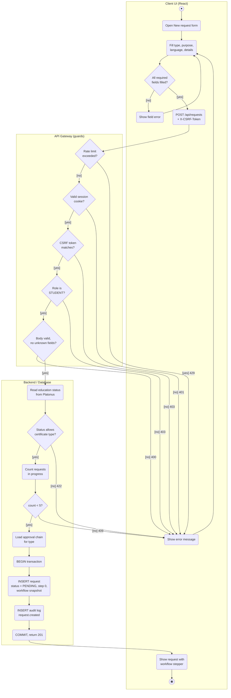
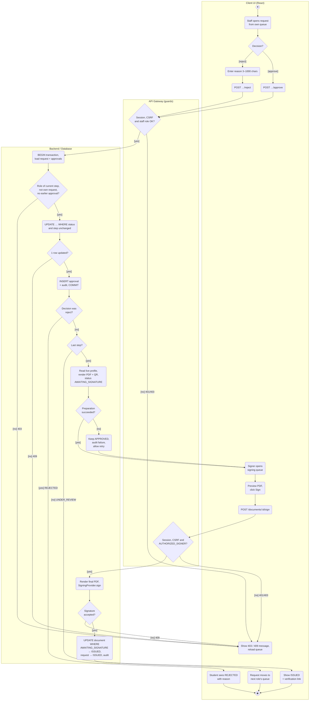

# Activity Diagrams (with swimlanes)

Each diagram has three vertical swimlanes:

| Lane | What runs there |
| --- | --- |
| **Client UI** | React app in the browser (`apps/web`) |
| **API Gateway** | Express/NestJS middleware and global guards: Helmet, rate limiter, `SessionGuard`, `CsrfGuard`, `RolesGuard`, `ValidationPipe` |
| **Backend / Database** | Services (`RequestsService`, `DocumentsService`, …), PostgreSQL via Prisma, Platonus provider |

Rounded nodes are actions, diamonds are decisions with guards in `[ ]`, the filled circle is the start and the bullseye is the end.

## 1. Submit a certificate request

Use case UC-02. Requirements FR-REQ-01 … FR-REQ-06.

## 2. Approve, sign and issue

Use cases UC-05 and UC-06. Requirements FR-WF-02 … FR-WF-06, FR-DOC-01 … FR-DOC-04. Gateway checks (rate limit, session, CSRF, role) are the same as in diagram 1 and are collapsed into one node.

