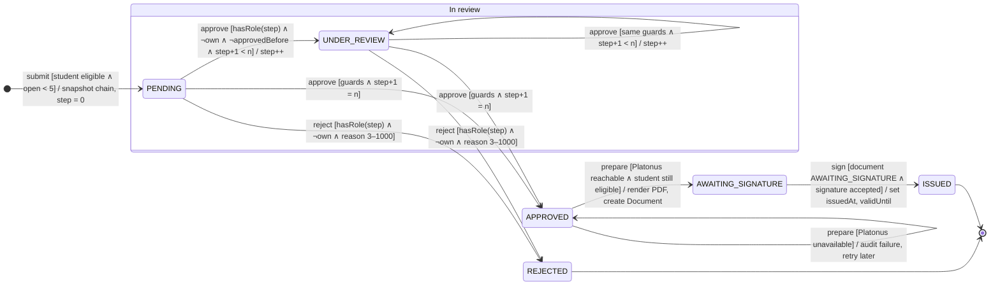
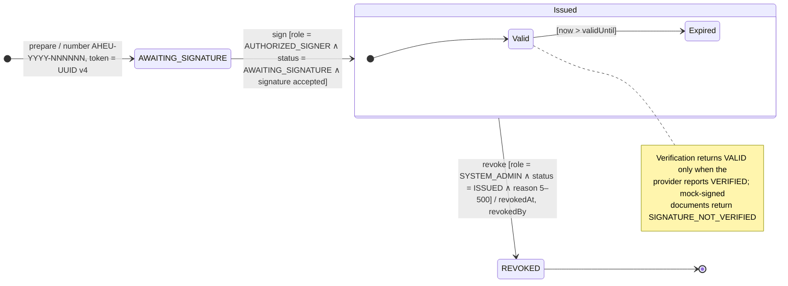
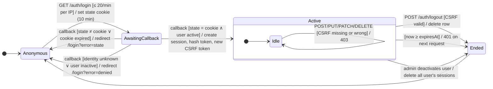

# State Machine Diagrams

Transitions are written `event [guard] / action`. Guards are the exact conditions checked by the API (see `apps/api/src/workflow/workflow-rules.ts`, `requests.service.ts`, `documents.service.ts`, `session.service.ts`). A transition whose guard fails leaves the entity in its current state and returns the HTTP error shown in the tables.

## 1. CertificateRequest lifecycle

Entity `certificate_requests.status` (`RequestStatus`). Requirements FR-REQ-06, FR-WF-02 … FR-WF-06, FR-DOC-01, FR-DOC-04.

| From | Event | Guard | To | On guard failure |
| --- | --- | --- | --- | --- |
| — | `POST /requests` | education status allows type; < 5 open requests | `PENDING` | 422 / 409 |
| `PENDING`, `UNDER_REVIEW` | approve | actor has current step's role; not own request; actor has not approved another step; status and step unchanged since read | `UNDER_REVIEW` (more steps) or `APPROVED` (last step) | 403 / 409 |
| `PENDING`, `UNDER_REVIEW` | reject | actor has current step's role; not own request; reason 3–1000 chars | `REJECTED` (final) | 403 / 400 / 409 |
| `APPROVED` | prepare (automatic after last approval, or manual retry) | student found in Platonus and still eligible | `AWAITING_SIGNATURE` | stays `APPROVED` |
| `AWAITING_SIGNATURE` | sign | caller is `AUTHORIZED_SIGNER`; document still `AWAITING_SIGNATURE`; signature valid | `ISSUED` (final) | 403 / 409 |

`n` is the number of steps in the request's own workflow snapshot (1–6), not the current configuration.

## 2. Document lifecycle

Entity `documents.status` (`DocumentStatus`) plus the derived verification status. Requirements FR-DOC-03 … FR-DOC-06, FR-VER-02, FR-ADM-05.

| Stored status | Derived condition | Public verification result |
| --- | --- | --- |
| `AWAITING_SIGNATURE` | — | `NOT_FOUND` (unsigned documents are never confirmed) |
| `REVOKED` | — | `REVOKED` |
| `ISSUED` | `now > validUntil` | `EXPIRED` |
| `ISSUED` | signature check = `VERIFIED` | `VALID` |
| `ISSUED` | signature check = `TEST_ONLY` / `NOT_VERIFIED` | `SIGNATURE_NOT_VERIFIED` |

`Expired` is a derived sub-state: nothing is written to the database when a certificate expires, the status is computed on every verification (`computeVerificationStatus`). A revoked document stays `REVOKED` even after `validUntil`, because revocation is checked first.

## 3. Session lifecycle

Entity `sessions` row plus the login `state` cookie. Requirements FR-AUTH-02 … FR-AUTH-08, FR-ADM-04.

| Guard | Where it is checked |
| --- | --- |
| `state = cookie` (constant-time compare) | `AuthController.callback` |
| token hash exists and not expired | `SessionGuard` → `SessionService.resolve` |
| CSRF header equals session token | `CsrfGuard` (all non-GET methods) |
| user has the endpoint's role | `RolesGuard` |
