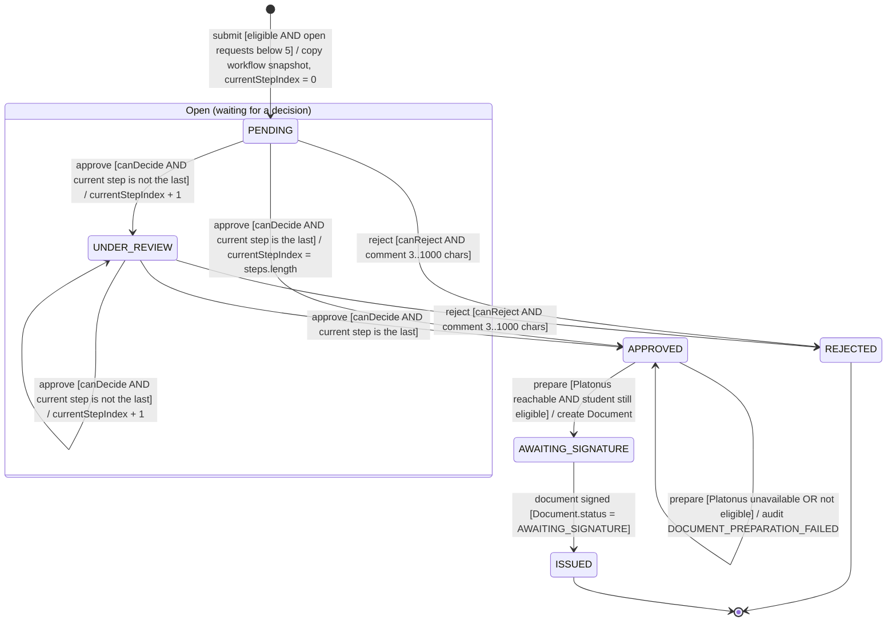
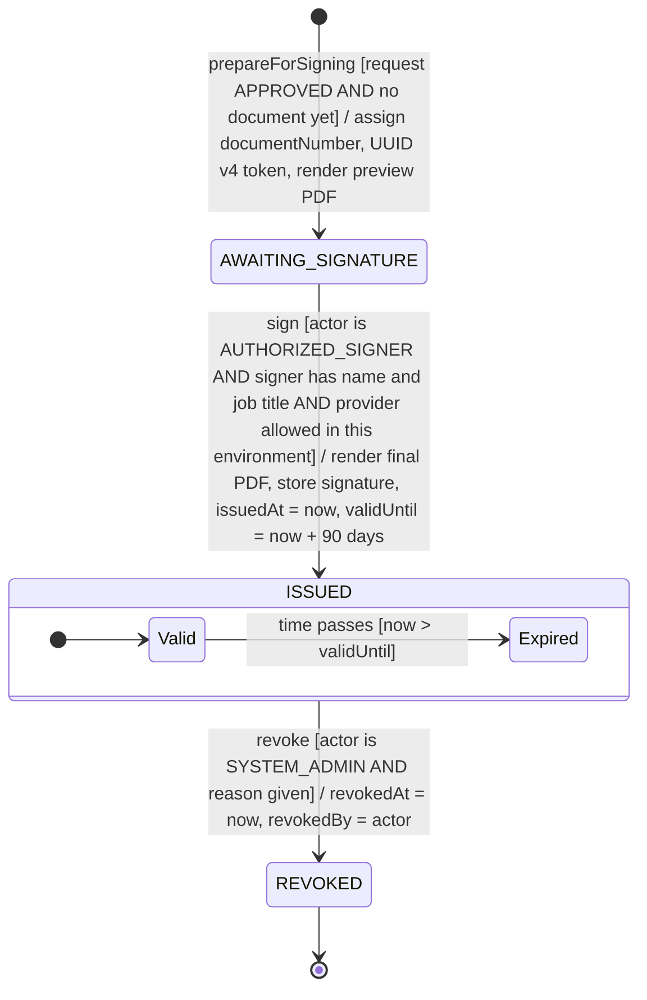
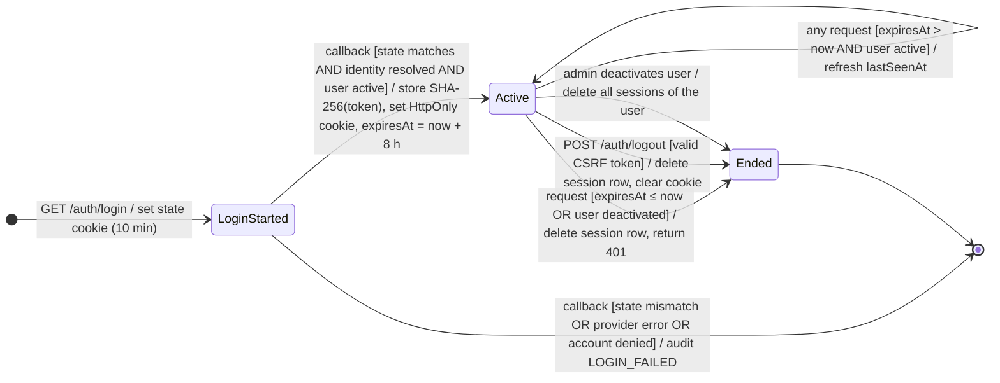

# State Machine Diagrams — UniDocs

Requirements: FR-AUTH-03…04, FR-REQ, FR-WF, FR-DOC, FR-VER. The states are the real enum values in [`schema.prisma`](../../../apps/api/prisma/schema.prisma). The transition rules are in [`workflow-rules.ts`](../../../apps/api/src/workflow/workflow-rules.ts), [`documents.service.ts`](../../../apps/api/src/documents/documents.service.ts) and [`session.service.ts`](../../../apps/api/src/auth/session.service.ts).

Transition labels use UML syntax: **`event [guard] / action`**. A transition fires only when its guard is true. Every state-changing update is a conditional `UPDATE … WHERE status = <expected>`, so if two users act at the same time only one transition succeeds and the other gets `409`.

## 1. Certificate request lifecycle

Entity: `CertificateRequest.status` (`RequestStatus`).

### Guards

| Guard | Exact condition (from `checkCanDecide`) |
| --- | --- |
| `canDecide` | status is `PENDING` or `UNDER_REVIEW` **and** the actor is not the requesting student **and** the actor has the role of `steps[currentStepIndex]` **and** the actor has not approved any earlier step of this request (separation of duties). |
| `canReject` | Same as `canDecide` except the separation-of-duties rule. |
| *current step is the last* | `currentStepIndex + 1 ≥ steps.length` (see `stateAfterApproval`). |
| *eligible* | `GRADUATION_CONFIRMATION` → education status `GRADUATED`. Any other type → `ACTIVE`. |

### State table

| State | Meaning | Who acts next | Final? |
| --- | --- | --- | --- |
| `PENDING` | Submitted. First step not decided yet. | Role of step 0 | No |
| `UNDER_REVIEW` | At least one step approved, more remain. | Role of the current step | No |
| `APPROVED` | All steps approved, PDF not prepared yet. | System, or a signer/admin retry | No |
| `AWAITING_SIGNATURE` | Preview PDF ready in the signer's queue. | Authorized signer | No |
| `ISSUED` | Signed. Student can download. | — | Yes |
| `REJECTED` | Rejected at some step, with a reason. | — | Yes |

> A rejected request is not reopened. The student submits a new one.

## 2. Document lifecycle

Entity: `Document.status` (`DocumentStatus`). `EXPIRED` is **not stored**: it is derived at verification time from `validUntil`, so it is drawn as a sub-state of `ISSUED`.

### What a verifier sees in each state

| Document state | `GET /api/documents/verify/{token}` returns |
| --- | --- |
| `AWAITING_SIGNATURE` | `NOT_FOUND` (unsigned documents are invisible to the public) |
| `ISSUED` › Valid, signature verified | `VALID` |
| `ISSUED` › Valid, signature not verified or test signature | `SIGNATURE_NOT_VERIFIED` |
| `ISSUED` › Expired | `EXPIRED` |
| `REVOKED` | `REVOKED` (wins over `EXPIRED`) |

## 3. Session lifecycle

Entity: `Session` row + `unidocs_sid` cookie.

| Guard | Where it is checked |
| --- | --- |
| *state matches* | `AuthController.callback` with constant-time comparison |
| *expiresAt > now AND user active* | `SessionService.resolve`, called by `SessionGuard` on every request |
| *valid CSRF token* | `CsrfGuard` for every state-changing method |
