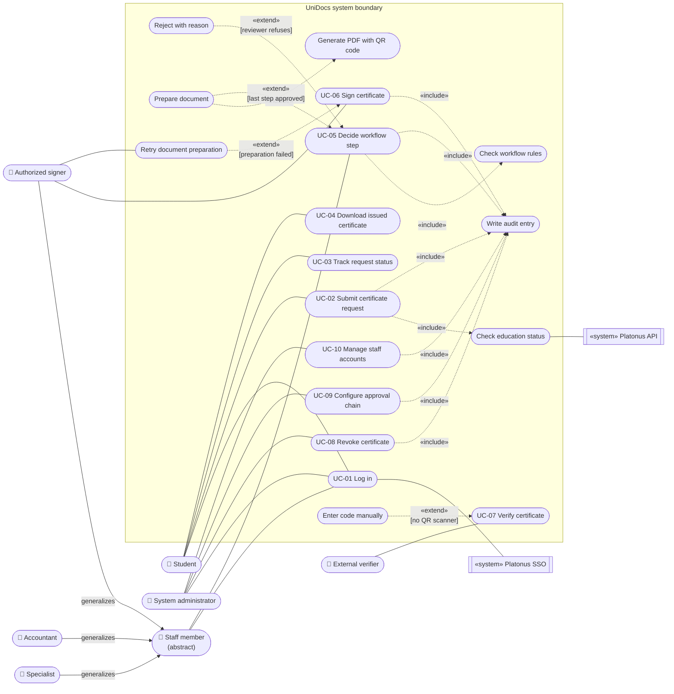

# Use Case Diagram

Requirements: [specifications.md](../../specifications.md). Mermaid has no native use-case notation, so actors are drawn as rounded nodes, use cases as stadiums inside the system boundary, and `«include»` / `«extend»` as dashed dependencies.

- **«include»**: the base use case always performs the included behaviour (arrow from base to included).
- **«extend»**: the extending use case adds behaviour to the base only when its condition holds (arrow from extension to base).

## Diagram

### Actors

| Actor | Type | Description |
| --- | --- | --- |
| Student | Primary, human | Requests and downloads their own certificates |
| Staff member | Abstract | Generalisation of Specialist, Accountant and Authorized signer: anyone who decides a workflow step |
| Specialist / Accountant | Primary, human | Decide the enrollment and financial-check steps |
| Authorized signer | Primary, human | Decides the final step and signs documents |
| System administrator | Primary, human | Manages staff, approval chain, revocation; not part of the approval chain |
| External verifier | Primary, human, anonymous | Checks a certificate's authenticity |
| Platonus SSO / API | Secondary, system | Identity provider and source of academic data |

---

## Use case specifications

### UC-01 Log in

| Field | Value |
| --- | --- |
| ID / Name | UC-01 Log in |
| Actors | Student, Staff member, System administrator (primary); Platonus SSO (secondary) |
| Requirements | FR-AUTH-01 … FR-AUTH-08 |
| Preconditions | The user has a Platonus account; staff have been provisioned by an administrator |
| Trigger | The user clicks **Login with Platonus** |
| Main flow | 1. System generates a random `state`, stores it in an HttpOnly cookie (10 min) and redirects to Platonus SSO. 2. User authenticates on the provider's own page. 3. Provider redirects back with `code` and `state`. 4. System compares `state` with the cookie (constant-time). 5. System exchanges `code` for a verified identity. 6. System maps the identity to a user. 7. System creates a session, sets the `unidocs_sid` cookie and redirects to the role's dashboard. |
| Alternative flows | 6a. Unknown student found in Platonus → system creates a `STUDENT` account (audited) and continues at 7. |
| Exception flows | 4a. `state` mismatch → login refused, no session. 6b. Deactivated user, unknown staff identity or student not found → login denied. |
| Postconditions | A server-side session exists; an audit entry `auth.login` is written |

### UC-02 Submit certificate request

| Field | Value |
| --- | --- |
| ID / Name | UC-02 Submit certificate request |
| Actors | Student (primary); Platonus API (secondary) |
| Requirements | FR-REQ-01 … FR-REQ-06 |
| Includes | **Check education status**, **Write audit entry** |
| Preconditions | Student is logged in (UC-01) and has fewer than 5 requests in progress |
| Trigger | Student opens **New request** |
| Main flow | 1. Student selects certificate type, purpose, language and optionally purpose details. 2. UI validates required fields. 3. System validates the body. 4. System «includes» *Check education status* against Platonus. 5. System counts requests in progress. 6. System snapshots the approval chain for the certificate type. 7. System saves the request as `PENDING`, step 0, and «includes» *Write audit entry*. 8. System returns HTTP 201; UI shows the request with its workflow stepper. |
| Exception flows | 3a. Invalid or unknown fields → HTTP 400, form shows the error. 4a. Status does not allow the type → HTTP 422. 5a. Already 5 in progress → HTTP 409. 4b. Platonus unavailable → HTTP 503, nothing saved. |
| Postconditions | Request is `PENDING` and appears in the first-step role's queue |

### UC-03 Track request status

| Field | Value |
| --- | --- |
| Actors | Student |
| Requirements | FR-REQ-07, FR-REQ-08 |
| Preconditions | Student is logged in |
| Main flow | 1. Student opens **My requests**. 2. System returns only the student's requests with steps and decisions. 3. UI shows status badge and workflow progress; refreshes every 15 s while the tab is visible. |
| Exception flows | 2a. Student opens another student's request ID → HTTP 404. |
| Postconditions | None (read only) |

### UC-04 Download issued certificate

| Field | Value |
| --- | --- |
| Actors | Student |
| Requirements | FR-DOC-05 |
| Preconditions | The student's document is `ISSUED` |
| Main flow | 1. Student opens **My documents**. 2. Student clicks **Download**. 3. System checks ownership and status, reads the signed PDF and writes an audit entry. 4. Browser saves the PDF. |
| Exception flows | 3a. Not the owner, or document not issued → HTTP 404. |
| Postconditions | Download is audited |

### UC-05 Decide workflow step

| Field | Value |
| --- | --- |
| Actors | Staff member (Specialist, Accountant or Authorized signer) |
| Requirements | FR-WF-01 … FR-WF-06 |
| Includes | **Check workflow rules**, **Write audit entry** |
| Extended by | **Reject with reason** [reviewer refuses]; **Prepare document** [last step approved] |
| Preconditions | Request is `PENDING` or `UNDER_REVIEW`; the staff member holds the current step's role |
| Trigger | Staff member opens a request from their queue |
| Main flow | 1. System shows the request with the student's live academic profile and previous decisions. 2. Staff member clicks **Approve** with an optional comment. 3. System «includes» *Check workflow rules* (correct role, not own request, not already approved another step). 4. System updates the request only if its status and step are unchanged, records the approval and «includes» *Write audit entry*. 5. Request moves to the next step (`UNDER_REVIEW`). |
| Alternative flows | 2a. «extend» *Reject with reason*: staff member enters a reason (3–1000 chars) → request becomes `REJECTED`; student sees the reason. 5a. «extend» *Prepare document*: the approved step was the last → request becomes `APPROVED` and the PDF is prepared (UC-06 precondition). |
| Exception flows | 3a. Rule violated → HTTP 403 with the reason. 4a. Another user decided first → HTTP 409, UI asks to reload. |
| Postconditions | One `approvals` row per decided step; audit entry written |

### UC-06 Sign certificate

| Field | Value |
| --- | --- |
| Actors | Authorized signer |
| Requirements | FR-DOC-01 … FR-DOC-04, FR-DOC-06 |
| Includes | **Write audit entry** |
| Extended by | **Retry document preparation** [preparation failed] |
| Preconditions | Document is `AWAITING_SIGNATURE`; signer profile has a name and job title |
| Main flow | 1. Signer opens the signing queue. 2. Signer previews the PDF and clicks **Sign**. 3. System renders the final PDF with signer's designation and QR code. 4. `SigningProvider` signs it. 5. System stores the signed file, marks document and request `ISSUED`, sets validity (default 90 days) and «includes» *Write audit entry*. |
| Alternative flows | 1a. «extend» *Retry document preparation*: an `APPROVED` request has no document because Platonus was down → signer clicks **Prepare** again. |
| Exception flows | 2a. Already signed by someone else → HTTP 409. 4a. Signature not valid → HTTP 409, document stays `AWAITING_SIGNATURE`. 4b. Mock provider in production → HTTP 403. |
| Postconditions | Document `ISSUED`; verifiable by its QR code |

### UC-07 Verify certificate

| Field | Value |
| --- | --- |
| Actors | External verifier (anonymous) |
| Requirements | FR-VER-01 … FR-VER-05 |
| Extended by | **Enter code manually** [no QR scanner] |
| Preconditions | None |
| Main flow | 1. Verifier scans the QR code on the certificate. 2. Browser opens `/verify/{token}`. 3. System evaluates status in order NOT_FOUND → REVOKED → EXPIRED → VALID / SIGNATURE_NOT_VERIFIED. 4. Page shows university, document number, type, dates, signer designation and status, without personal data. |
| Alternative flows | 1a. «extend» *Enter code manually*: verifier opens `/verify` and pastes the code or link. |
| Exception flows | 3a. More than 30 checks/min from one IP → HTTP 429. |
| Postconditions | None (read only) |

### UC-08 Revoke certificate

| Field | Value |
| --- | --- |
| Actors | System administrator |
| Requirements | FR-ADM-05 |
| Includes | **Write audit entry** |
| Preconditions | Document is `ISSUED` |
| Main flow | 1. Admin finds the request. 2. Admin clicks **Revoke**, enters a reason (5–500 chars) and confirms. 3. System sets the document to `REVOKED` with time, reason and actor, and «includes» *Write audit entry*. |
| Exception flows | 3a. Document is not `ISSUED` → HTTP 409. |
| Postconditions | Verification returns `REVOKED` |

### UC-09 Configure approval chain

| Field | Value |
| --- | --- |
| Actors | System administrator |
| Requirements | FR-WF-07 |
| Includes | **Write audit entry** |
| Main flow | 1. Admin opens **Approval chain**. 2. Admin edits the default chain or an override for one certificate type. 3. System validates 1–6 steps, approver roles only, last step `AUTHORIZED_SIGNER`. 4. System replaces the steps in a transaction and audits the change. |
| Exception flows | 3a. Invalid chain → HTTP 400 with the reason. |
| Postconditions | New requests use the new chain; requests in progress keep their snapshot |

### UC-10 Manage staff accounts

| Field | Value |
| --- | --- |
| Actors | System administrator |
| Requirements | FR-ADM-01 … FR-ADM-04 |
| Includes | **Write audit entry** |
| Main flow | 1. Admin searches users. 2. Admin provisions a staff account (provider, external ID, name, job title, roles) or changes roles / active status. 3. System validates and saves, and audits the change. |
| Exception flows | 2a. Admin targets their own account → HTTP 403. 2b. Staff role on a student account, or `STUDENT` role requested → HTTP 400. |
| Postconditions | Deactivated users lose all sessions immediately |
