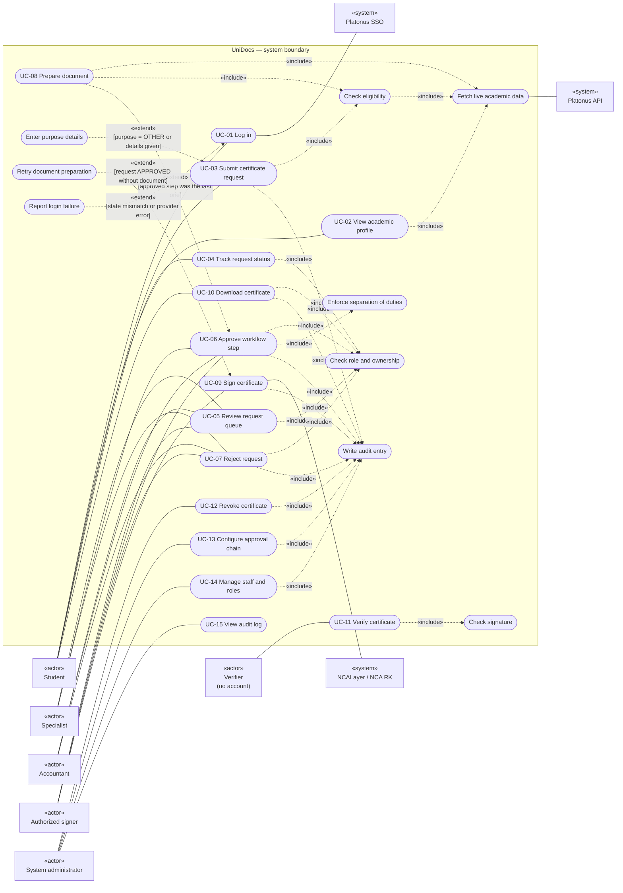

# Use Case Diagram — UniDocs

Requirements: [SRS](../../specifications.md). Notation: actors on the outside, use cases (ovals) inside the system boundary. A solid line means an actor takes part in a use case. A dashed arrow labelled «include» points from a base use case to a use case it **always** runs. A dashed arrow labelled «extend» points from an optional use case to the base use case it extends **under a condition**.

## 1. Diagram

> Mermaid has no native use case diagram, so it is drawn as a flowchart: rounded ovals are use cases, boxes marked «actor» are actors, boxes marked «system» are external secondary actors. Every staff use case (UC-05…UC-15) also needs UC-01, which is left out of the drawing to keep it readable.

## 2. Actors

| Actor | Type | Description |
| --- | --- | --- |
| Student | Primary, human | Enrolled or graduated AHEU student, logs in through Platonus. |
| Specialist | Primary, human | Registrar staff. Usually the first approval step (enrollment check). |
| Accountant | Primary, human | Financial check step. |
| Authorized signer | Primary, human | Final approval and qualified electronic signature. |
| System administrator | Primary, human | Users, roles, approval chains, revocation, audit. |
| Verifier | Primary, human, anonymous | Employer, embassy, bank… Scans the QR code. |
| Platonus SSO | Secondary, system | Confirms the user's identity (`AuthProvider`). |
| Platonus API | Secondary, system | Source of academic data (`StudentDataProvider`). |
| NCALayer / NCA RK | Secondary, system | Produces legally valid signatures (`SigningProvider`). |

## 3. Relationship summary

| Base use case | Relationship | Target | Condition / reason |
| --- | --- | --- | --- |
| UC-03 Submit certificate request | «include» | Check eligibility | Always: status must allow the certificate type (FR-REQ-02). |
| UC-03 Submit certificate request | «include» | Write audit entry | Always: `REQUEST_CREATED`. |
| Check eligibility | «include» | Fetch live academic data | Always: status is read from Platonus. |
| UC-06 Approve workflow step | «include» | Check role and ownership, Enforce separation of duties, Write audit entry | Always. |
| UC-08 Prepare document | «extend» | UC-06 Approve workflow step | Only when the approved step was the last one. |
| Retry document preparation | «extend» | UC-09 Sign certificate | Only when an `APPROVED` request has no document yet (Platonus was down). |
| Enter purpose details | «extend» | UC-03 Submit certificate request | Only when the student adds free-text details (optional field, ≤ 200 chars). |
| Report login failure | «extend» | UC-01 Log in | Only on `state` mismatch, denied code or provider error. |
| UC-11 Verify certificate | «include» | Check signature | Always for signed documents. |

## 4. Use case specifications

### UC-01 Log in

| Field | Description |
| --- | --- |
| ID / Name | UC-01 Log in |
| Primary actor | Any user with an account (student or staff) |
| Secondary actor | Platonus SSO |
| Related requirements | FR-AUTH-01…05 |
| Preconditions | The user has a Platonus account. For staff: an active UniDocs account with at least one role. |
| Trigger | User clicks *Log in with Platonus*. |
| Main success scenario | 1. System creates a random `state`, stores it in a 10-minute `HttpOnly` cookie and redirects to Platonus SSO. 2. User authenticates at Platonus. 3. Platonus redirects back with `code` and `state`. 4. System checks that `state` matches the cookie. 5. System exchanges `code` for an identity and finds or creates the user. 6. System creates a session, sets the session cookie and writes `LOGIN` to the audit log. 7. System redirects to `/dashboard`, which opens the dashboard for the user's role. |
| Extensions | 4a. `state` does not match → «extend» *Report login failure*: redirect to `/login?error=state`. 5a. Provider unavailable → redirect to `/login?error=unavailable`, audit `LOGIN_FAILED`. 5b. Account deactivated, staff account not provisioned by an administrator, or student unknown to Platonus → `403`, redirect to `/login?error=denied`. 5c. First login of a known student → student account is created with role `STUDENT` (audit `USER_PROVISIONED`). |
| Postconditions | Success: valid session exists for 8 hours (configurable). Failure: no session, failure recorded in the audit log. |
| Includes / Extends | Extended by *Report login failure*. |

### UC-03 Submit certificate request

| Field | Description |
| --- | --- |
| ID / Name | UC-03 Submit certificate request |
| Primary actor | Student |
| Secondary actor | Platonus API |
| Related requirements | FR-REQ-01…04, NFR-USE-03 |
| Preconditions | Student is logged in (UC-01). |
| Trigger | Student opens *New request* and presses *Submit*. |
| Main success scenario | 1. Student selects certificate type, purpose and language. 2. Student submits the form. 3. System validates the input. 4. System «include» *Check eligibility*: reads the education status from Platonus and checks it allows this type. 5. System checks the student has fewer than 5 requests in progress. 6. System copies the current approval chain into the request. 7. System saves the request with status `PENDING` and «include» *Write audit entry*. 8. System shows the request page with a progress bar. |
| Extensions | 1a. Student adds details → «extend» *Enter purpose details* (≤ 200 printable characters). 3a. Invalid input → `400`, the form shows the field error. 4a. Student not found in Platonus → `403`. 4b. Status does not allow the type (e.g. graduation confirmation for an active student) → `422`. 4c. Platonus unavailable → `503`, student is asked to try later. 5a. Already 5 open requests → `409`. |
| Postconditions | Success: new `CertificateRequest` in `PENDING`, visible in the first approver's queue. Failure: nothing stored. |
| Includes / Extends | Includes *Check eligibility*, *Write audit entry*. Extended by *Enter purpose details*. |

### UC-04 Track request status

| Field | Description |
| --- | --- |
| Primary actor | Student |
| Related requirements | FR-REQ-05, FR-REQ-06 |
| Preconditions | Student is logged in. |
| Main success scenario | 1. Student opens *My requests*. 2. System lists only the student's own requests, newest first. 3. Student opens a request. 4. System «include» *Check role and ownership* and shows status, completed steps with comments, and remaining steps. |
| Extensions | 4a. Request belongs to someone else or does not exist → `404` (no hint that it exists). |
| Postconditions | No data changes. |

### UC-06 Approve workflow step

| Field | Description |
| --- | --- |
| Primary actor | Specialist, Accountant or Authorized signer (whoever owns the current step) |
| Related requirements | FR-WF-01, 02, 04, 05 |
| Preconditions | Staff member is logged in. Request is `PENDING` or `UNDER_REVIEW`. |
| Trigger | Staff member presses *Approve* on a request in their queue (UC-05). |
| Main success scenario | 1. System shows the request and the student's live Platonus profile. 2. Staff member optionally writes a comment and approves. 3. System «include» *Check role and ownership*: the actor has the current step's role and is not the requesting student. 4. System «include» *Enforce separation of duties*: the actor has not approved another step of this request. 5. System moves the request to the next step (`UNDER_REVIEW`), stores the approval and «include» *Write audit entry*. 6. System returns the updated request. |
| Extensions | 3a. Wrong role, own request, or request not open → `403`. 4a. Actor already approved an earlier step → `403`. 5a. Another staff member decided the same step first → `409`, user reloads. 5b. The approved step was the last one → status `APPROVED`, then «extend» *UC-08 Prepare document*. |
| Postconditions | One `Approval` row per decided step. The request is in the next step or `APPROVED`. |
| Includes / Extends | Includes *Check role and ownership*, *Enforce separation of duties*, *Write audit entry*. Extended by UC-08. |

### UC-07 Reject request

| Field | Description |
| --- | --- |
| Primary actor | Owner of the current step |
| Related requirements | FR-WF-03, FR-WF-04 |
| Preconditions | Request is `PENDING` or `UNDER_REVIEW`. |
| Main success scenario | 1. Staff member enters a reason (3–1000 characters) and presses *Reject*. 2. System checks role and ownership. 3. System sets status `REJECTED`, stores the decision and writes the audit entry. 4. Student sees the reason on the request page. |
| Extensions | 1a. Comment missing or too short → `400`. 2a. Not allowed → `403`. 3a. Concurrent decision → `409`. |
| Postconditions | Request is `REJECTED` (final). The student may submit a new request. |

### UC-08 Prepare document

| Field | Description |
| --- | --- |
| Primary actor | System (triggered by the last approval). Also an Authorized signer or Administrator via retry. |
| Secondary actor | Platonus API |
| Related requirements | FR-DOC-01, FR-DOC-02, NFR-AVL-04 |
| Preconditions | Request is `APPROVED` and has no document. |
| Main success scenario | 1. System «include» *Fetch live academic data* from Platonus. 2. System «include» *Check eligibility* again (status may have changed). 3. System freezes the data as a snapshot, assigns the next document number and a random UUID v4 verification token. 4. System renders the unsigned preview PDF with the QR code and stores it. 5. System creates the `Document` (`AWAITING_SIGNATURE`) and moves the request to `AWAITING_SIGNATURE`. |
| Extensions | 1a. Platonus unavailable → request stays `APPROVED`, audit `DOCUMENT_PREPARATION_FAILED`. The request appears under *Awaiting preparation* in the signer's queue. 2a. Student no longer eligible → `409`, request stays `APPROVED`. |
| Postconditions | The document is in the signer's queue. |

### UC-09 Sign certificate

| Field | Description |
| --- | --- |
| Primary actor | Authorized signer |
| Secondary actor | NCALayer / NCA RK (mock signing provider in development) |
| Related requirements | FR-DOC-03…06 |
| Preconditions | Document is `AWAITING_SIGNATURE`. The signer's profile has a display name and job title. |
| Trigger | Signer opens the signing queue, previews the PDF and presses *Sign*. |
| Main success scenario | 1. System shows the documents awaiting signature and whether the active provider is legally valid. 2. Signer opens the preview PDF. 3. Signer presses *Sign*. With NCALayer, the signature is created on the signer's computer. 4. System renders the final PDF with issue date, expiry date and signer. 5. Signing provider signs the PDF. 6. System stores the signed file, sets the document to `ISSUED` and the request to `ISSUED`, records the signature and «include» *Write audit entry*. |
| Extensions | 1a. Approved request without document → «extend» *Retry document preparation* (UC-08 again). 3a. Signer profile incomplete → `409`. 5a. Production with mock provider → `403`. 5b. Production signature not valid → `409`. 6a. Document already signed by someone else → `409`. |
| Postconditions | Document `ISSUED`, valid for 90 days (configurable). The student can download it. |

### UC-11 Verify certificate

| Field | Description |
| --- | --- |
| Primary actor | Verifier (anonymous) |
| Related requirements | FR-VER-01…05, NFR-AVL-02, NFR-PERF-03 |
| Preconditions | Verifier holds a printed or PDF certificate with a QR code. |
| Trigger | Verifier scans the QR code, which opens `/verify/{token}`. |
| Main success scenario | 1. Web page calls `GET /api/documents/verify/{token}`. 2. System checks the token format and finds the signed document. 3. System «include» *Check signature* with the provider that signed it. 4. System computes the status: revoked → `REVOKED`, past `validUntil` → `EXPIRED`, signature verified → `VALID`. 5. Page shows the status, document number, type, issue and expiry dates and the signer's job title. It shows no personal data. |
| Extensions | 2a. Malformed token, unknown token, or document not signed yet → `NOT_FOUND`. 3a. Signature cannot be verified → `SIGNATURE_NOT_VERIFIED`. 3b. Mock (test) signature → `SIGNATURE_NOT_VERIFIED` with `isTestDocument = true`, and the page shows a *TEST / NOT LEGALLY SIGNED* warning. 1a. More than 30 checks per minute → `429`. |
| Postconditions | No data changes. |

### UC-12 Revoke certificate

| Field | Description |
| --- | --- |
| Primary actor | System administrator |
| Related requirements | FR-DOC-08 |
| Preconditions | Document is `ISSUED`. |
| Main success scenario | 1. Administrator finds the document in the requests overview. 2. Administrator enters a reason and confirms. 3. System sets the document to `REVOKED` with time, reason and administrator, and writes the audit entry. 4. From now on, verification returns `REVOKED`. |
| Extensions | 3a. Document is not `ISSUED` → `409`. |
| Postconditions | Document `REVOKED` (final). |

### UC-13 Configure approval chain

| Field | Description |
| --- | --- |
| Primary actor | System administrator |
| Related requirements | FR-WF-06 |
| Main success scenario | 1. Administrator opens *Workflow*. 2. Administrator edits the default chain or the override for one certificate type. 3. System validates: 1–6 steps, only approver roles, last step `AUTHORIZED_SIGNER`. 4. System replaces the chain in one transaction and writes the audit entry. |
| Extensions | 3a. Invalid chain → `400` with the reason. 2a. Empty list for a type → the override is removed and the default chain is used. |
| Postconditions | New requests use the new chain. Requests already submitted keep their snapshot. |

### UC-02, UC-05, UC-10, UC-14, UC-15 (short form)

| ID | Name | Actor | Main flow | Exceptions | Requirements |
| --- | --- | --- | --- | --- | --- |
| UC-02 | View academic profile | Student | System «include» *Fetch live academic data* and shows faculty, specialty, course, group, study form and status. | Platonus down → message *data source unavailable*. | FR-REQ-02 |
| UC-05 | Review request queue | Specialist, Accountant, Signer | System lists open requests whose current step needs one of the actor's roles, oldest first. | — | FR-WF-01 |
| UC-10 | Download certificate | Student (own), staff (any) | System checks ownership, reads the signed PDF and writes `DOCUMENT_DOWNLOADED`. | Not own, or not `ISSUED` → `404`. | FR-DOC-07 |
| UC-14 | Manage staff and roles | Administrator | Create a staff user, change roles, activate or deactivate. Deactivation ends all sessions. | Changing own status → `403`. | FR-ADM-01…03 |
| UC-15 | View audit log | Administrator | Paged list of audit entries, filter by action. | — | FR-ADM-04, 05 |
