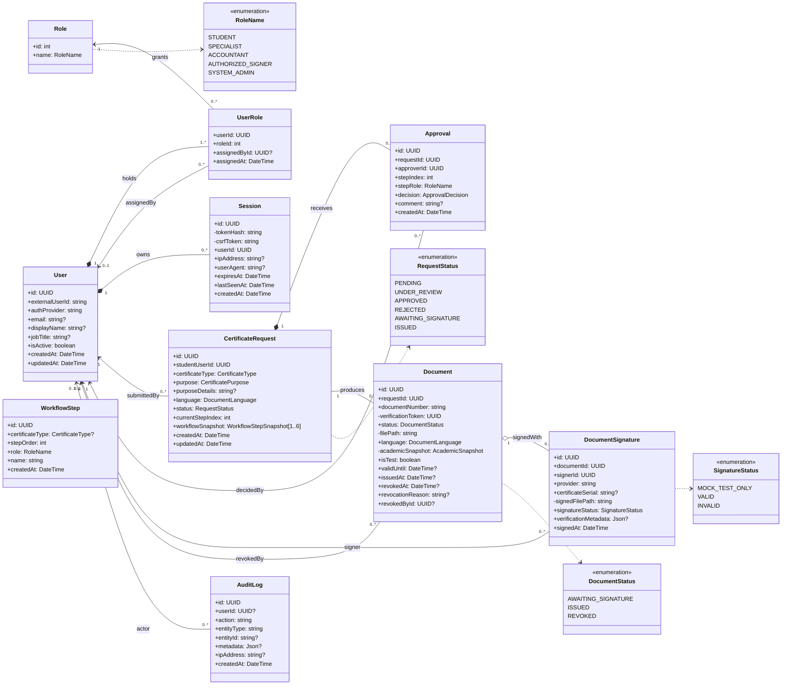

# UML Class Diagrams

Two views of the same system:

1. **Domain model**: the persistent entities (Prisma models in `apps/api/prisma/schema.prisma`) with typed attributes and exact multiplicities.
2. **Service layer**: the classes and interfaces that implement the behaviour (`apps/api/src`), with visibility and method signatures.

Notation: `+` public, `-` private, `#` protected; `?` marks a nullable type; `$` marks a static member. Multiplicities are written at both ends of each association (`1`, `0..1`, `0..*`, `1..*`, `1..6`).

## 1. Domain model

### Multiplicities explained

| Association | Multiplicity | Enforced by |
| --- | --- | --- |
| User — UserRole | 1 to 1..* | Students get `STUDENT` on creation; admin endpoints reject an empty role list. Composition: role grants are deleted with the user (`onDelete: Cascade`) |
| Role — UserRole | 1 to 0..* | FK `role_id`, `RESTRICT` |
| User — Session | 1 to 0..* | FK `user_id`, `CASCADE` |
| User — CertificateRequest | 1 to 0..* | FK `student_user_id`, `RESTRICT` |
| CertificateRequest — Approval | 1 to 0..6 | Unique `(request_id, step_index)`; chain has at most 6 steps |
| CertificateRequest — Document | 1 to 0..1 | Unique `documents.request_id` |
| Document — DocumentSignature | 1 to 0..* | FK `document_id`, `RESTRICT` (one signature in practice; history allowed) |
| User — AuditLog | 0..1 to 0..* | FK `user_id`, `SET NULL` (system actions have no actor) |

`WorkflowStep` has no association: requests copy the chain into `workflowSnapshot` at submission so configuration changes never affect requests in progress.

## 2. Service layer

```mermaid
classDiagram
  direction TB

  class RequestsController {
    -requests: RequestsService
    +create(user: AuthContext, dto: CreateRequestDto, ip: string) Promise~RequestView~
    +my(user: AuthContext) Promise~RequestView[]~
    +get(id: UUID, user: AuthContext) Promise~RequestView~
  }

  class StaffController {
    -requests: RequestsService
    -students: StudentDataProvider
    +list(user: AuthContext) Promise~StaffRequestView[]~
    +details(id: UUID, user: AuthContext) Promise~StaffRequestDetails~
    +approve(id: UUID, dto: ApproveDto, user: AuthContext) Promise~RequestView~
    +reject(id: UUID, dto: RejectDto, user: AuthContext) Promise~RequestView~
  }

  class DocumentsController {
    -documents: DocumentsService
    +my(user: AuthContext) Promise~DocumentSummary[]~
    +signingQueue() Promise~SigningQueue~
    +prepare(requestId: UUID, user: AuthContext) Promise~DocumentSummary~
    +sign(id: UUID, dto: SignDto, user: AuthContext) Promise~DocumentSummary~
    +download(id: UUID, user: AuthContext, res: Response) Promise~void~
    +verify(token: string) Promise~VerificationResult~
  }

  class RequestsService {
    +MAX_OPEN_REQUESTS_PER_STUDENT$: int = 5
    -prisma: PrismaService
    -workflow: WorkflowService
    -students: StudentDataProvider
    -documents: DocumentsService
    -audit: AuditService
    +create(student: AuthContext, dto: CreateRequestDto, ip: string?) Promise~RequestView~
    +listMine(studentUserId: UUID) Promise~RequestView[]~
    +getForUser(id: UUID, user: AuthContext) Promise~RequestView~
    +listActionable(user: AuthContext) Promise~StaffRequestView[]~
    +listAll(status: RequestStatus?) Promise~StaffRequestView[]~
    +approve(id: UUID, user: AuthContext, comment: string?, ip: string?) Promise~RequestView~
    +reject(id: UUID, user: AuthContext, comment: string, ip: string?) Promise~RequestView~
    -tryPrepareDocument(requestId: UUID, actorId: UUID, ip: string?) Promise~void~
  }

  class WorkflowRules {
    <<module>>
    +checkCanDecide(request: WorkflowRequestState, actor: WorkflowActor, previousApproverIds: UUID[]) DecisionCheck
    +stateAfterApproval(steps: WorkflowStepSnapshot[], currentStepIndex: int) NextState
    +validateWorkflowSteps(steps: WorkflowStepSnapshot[]) string?
    +parseWorkflowSnapshot(value: unknown) WorkflowStepSnapshot[]
  }

  class WorkflowService {
    -prisma: PrismaService
    -audit: AuditService
    +getStepsFor(type: CertificateType) Promise~WorkflowStepSnapshot[]~
    +getConfiguration() Promise~WorkflowConfiguration~
    +replaceSteps(type: CertificateType?, steps: WorkflowStepSnapshot[], actorId: UUID, ip: string?) Promise~void~
  }

  class DocumentsService {
    -prisma: PrismaService
    -students: StudentDataProvider
    -signing: SigningProviders
    -storage: StorageService
    -audit: AuditService
    -config: AppConfig
    +prepareForSigning(requestId: UUID, actorId: UUID, ip: string?) Promise~UUID~
    +sign(documentId: UUID, signer: AuthContext, clientSignature: string?, ip: string?) Promise~DocumentSummary~
    +getSummary(documentId: UUID) Promise~DocumentSummary~
    +listForStudent(studentUserId: UUID) Promise~DocumentSummary[]~
    +getDownload(documentId: UUID, user: AuthContext, ip: string?) Promise~DownloadableFile~
    +verify(token: string) Promise~VerificationResult~
    +revoke(documentId: UUID, reason: string, actorId: UUID, ip: string?) Promise~DocumentSummary~
    -checkSignature(signature: DocumentSignature) Promise~SignatureCheck~
    -nextDocumentNumber() Promise~string~
  }

  class AdminService {
    -prisma: PrismaService
    -sessions: SessionService
    -audit: AuditService
    -config: AppConfig
    +listUsers(query: UsersQueryDto) Promise~AdminUserView[]~
    +createStaffUser(dto: CreateStaffUserDto, actorId: UUID, ip: string?) Promise~AdminUserView~
    +updateRoles(targetId: UUID, roles: RoleName[], actorId: UUID, ip: string?) Promise~AdminUserView~
    +updateStatus(targetId: UUID, isActive: boolean, actorId: UUID, ip: string?) Promise~AdminUserView~
    +listAuditLogs(query: AuditLogsQueryDto) Promise~Page~AuditLogView~~
  }

  class AuthService {
    -prisma: PrismaService
    -students: StudentDataProvider
    -audit: AuditService
    +resolveUser(identity: ExternalIdentity, ip: string?) Promise~ResolvedUser~
  }

  class SessionService {
    -prisma: PrismaService
    -config: AppConfig
    +create(userId: UUID, ip: string?, userAgent: string?) Promise~CreatedSession~
    +resolve(token: string) Promise~AuthContext?~
    +destroy(sessionId: UUID) Promise~void~
    +destroyAllForUser(userId: UUID) Promise~void~
    +deleteExpired() Promise~int~
  }

  class AuditService {
    -prisma: PrismaService
    +log(entry: AuditEntry, db: DbClient) Promise~void~
  }

  class StorageService {
    -baseDir: string
    +savePdf(folder: StorageFolder, content: Buffer) Promise~string~
    +read(relativePath: string) Promise~Buffer~
    +resolveInside(relativePath: string) string
  }

  class AuthProvider {
    <<interface>>
    +name: string
    +buildAuthorizationUrl(state: string) string
    +handleCallback(code: string) Promise~ExternalIdentity~
  }
  class StudentDataProvider {
    <<interface>>
    +getStudentById(externalStudentId: string) Promise~StudentAcademicProfile?~
    +getCurrentStudent(identity: StudentIdentity) Promise~StudentAcademicProfile~
    +getStudentAcademicStatus(externalStudentId: string) Promise~StudentAcademicStatus?~
  }
  class SigningProvider {
    <<interface>>
    +name: string
    +legallyValid: boolean
    +pdfMode: PdfMode
    +sign(input: SignInput) Promise~SignResult~
    +verify(input: VerifyInput) Promise~SignatureCheck~
  }

  class MockAuthProvider
  class PlatonusSsoProvider
  class MockStudentDataProvider
  class PlatonusStudentDataProvider
  class MockSigningProvider
  class OfficialSigningProvider

  class SessionGuard {
    -sessions: SessionService
    +canActivate(ctx: ExecutionContext) Promise~boolean~
  }
  class CsrfGuard {
    +canActivate(ctx: ExecutionContext) boolean
  }
  class RolesGuard {
    -reflector: Reflector
    +canActivate(ctx: ExecutionContext) boolean
  }

  RequestsController "1" --> "1" RequestsService
  StaffController "1" --> "1" RequestsService
  DocumentsController "1" --> "1" DocumentsService
  RequestsService ..> WorkflowRules : uses
  RequestsService "1" --> "1" WorkflowService
  RequestsService "1" --> "1" DocumentsService
  RequestsService "1" --> "1" StudentDataProvider
  DocumentsService "1" --> "1" StudentDataProvider
  DocumentsService "1" --> "1..*" SigningProvider : active + byName
  DocumentsService "1" --> "1" StorageService
  WorkflowService ..> WorkflowRules : uses
  AuthService "1" --> "1" StudentDataProvider
  AdminService "1" --> "1" SessionService
  SessionGuard "1" --> "1" SessionService
  RequestsService "1" --> "1" AuditService
  DocumentsService "1" --> "1" AuditService
  AdminService "1" --> "1" AuditService
  AuthService "1" --> "1" AuditService

  AuthProvider <|.. MockAuthProvider
  AuthProvider <|.. PlatonusSsoProvider
  StudentDataProvider <|.. MockStudentDataProvider
  StudentDataProvider <|.. PlatonusStudentDataProvider
  SigningProvider <|.. MockSigningProvider
  SigningProvider <|.. OfficialSigningProvider
```

The three `«interface»` classes are the integration boundaries: the concrete class is chosen from environment variables at start-up (`AUTH_PROVIDER`, `STUDENT_DATA_PROVIDER`, `SIGNING_PROVIDER`), and the API refuses to start in production with any mock implementation.
