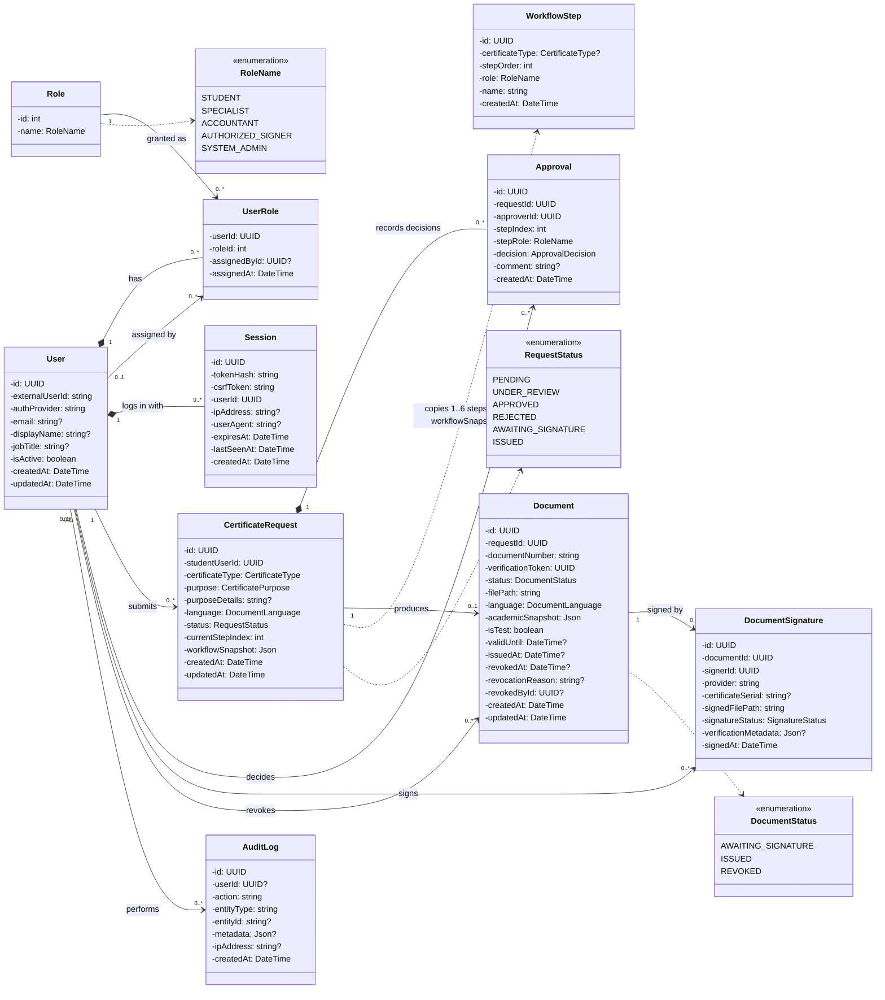

# UML Class Diagrams — UniDocs

Responsibilities of every class: [CRC cards](crc-cards.md). Table-level detail (column names, indexes, `ON DELETE` rules): [database-schema.md](../../database-schema.md).

Notation:

- **Visibility:** `+` public, `-` private, `#` protected.
- **Attributes:** `name: Type`. `Type?` means optional (multiplicity `0..1`, nullable column).
- **Methods:** `name(param: Type) ReturnType`. `Promise~T~` is `Promise<T>`.
- **Multiplicities** are written at both ends of every association: `1`, `0..1`, `0..*`, `1..*`, `1..6`.
- **Arrows:** `*--` composition (the part is deleted with the whole), `-->` association, `..>` dependency, `<|..` realization (class implements interface).

## 1. Domain model (persistent entities)

Entities are Prisma models, so their attributes are private fields read through the generated client. Entities have no behaviour of their own: state changes are done by the services in section 2.

Multiplicity notes:

- **User 1 — 0..* CertificateRequest.** Only users with the `STUDENT` role submit requests. A student has **at most 5** requests in progress (FR-REQ-03). That limit is enforced by `RequestsService`, not by the schema.
- **CertificateRequest 1 — 0..* Approval.** At most one approval per step: unique key `(requestId, stepIndex)`. A chain has 1–6 steps, so in practice it is `0..6`.
- **CertificateRequest 1 — 0..1 Document.** `Document.requestId` is unique: one certificate per request.
- **Composition** (`*--`) marks the `ON DELETE CASCADE` relations: a user's roles and sessions, and a request's approvals.

Enumerations not drawn to keep the diagram readable: `CertificateType` (6 values), `CertificatePurpose` (6), `DocumentLanguage` (KK, RU, EN), `ApprovalDecision` (APPROVED, REJECTED), `SignatureStatus` (MOCK_TEST_ONLY, VALID, INVALID). See [`schema.prisma`](../../../apps/api/prisma/schema.prisma).

## 2. Application layer (services, rules, providers)

Signatures are copied from the TypeScript source. `ip` stands for the `ipAddress: string | null` parameter that most write methods take for the audit log.

```mermaid
classDiagram
  direction TB

  class RequestsController {
    -requests: RequestsService
    +create(dto: CreateRequestDto, user: AuthContext, req: AppRequest) Promise~RequestView~
    +my(user: AuthContext) Promise~RequestView[]~
    +get(id: string, user: AuthContext) Promise~RequestView~
  }

  class StaffController {
    -requests: RequestsService
    -students: StudentDataProvider
    +list(user: AuthContext) Promise~StaffRequestView[]~
    +details(id: string, user: AuthContext) Promise~StaffRequestDetails~
    +approve(id: string, body: ApproveRequestDto, user: AuthContext, req: AppRequest) Promise~RequestView~
    +reject(id: string, body: RejectRequestDto, user: AuthContext, req: AppRequest) Promise~RequestView~
  }

  class DocumentsController {
    -documents: DocumentsService
    -prisma: PrismaService
    -signing: SigningProviders
    +my(user: AuthContext) Promise~DocumentSummary[]~
    +signingQueue() Promise~SigningQueue~
    +prepare(requestId: string, user: AuthContext, req: AppRequest) Promise~DocumentSummary~
    +download(id: string, inline: string?, user: AuthContext, req: AppRequest, res: Response) Promise~StreamableFile~
    +sign(id: string, body: SignDocumentDto, user: AuthContext, req: AppRequest) Promise~DocumentSummary~
    +verify(token: string) Promise~VerificationResult~
  }

  class RequestsService {
    -logger: Logger
    -prisma: PrismaService
    -audit: AuditService
    -workflow: WorkflowService
    -documents: DocumentsService
    -students: StudentDataProvider
    +create(student: AuthContext, dto: CreateRequestDto, ip: string?) Promise~RequestView~
    +listMine(studentUserId: string) Promise~RequestView[]~
    +getForUser(id: string, user: AuthContext) Promise~RequestView~
    +listActionable(user: AuthContext) Promise~StaffRequestView[]~
    +listAll(status: RequestStatus?) Promise~StaffRequestView[]~
    +approve(id: string, user: AuthContext, comment: string?, ip: string?) Promise~RequestView~
    +reject(id: string, user: AuthContext, comment: string, ip: string?) Promise~RequestView~
    -tryPrepareDocument(requestId: string, actorId: string, ip: string?) Promise~void~
    -withStudentNames(requests: RequestWithRelations[]) Promise~StaffRequestView[]~
    -studentNames(externalIds: string[]) Promise~Map~
  }

  class WorkflowService {
    -prisma: PrismaService
    -audit: AuditService
    +getStepsFor(type: CertificateType) Promise~WorkflowStepSnapshot[]~
    +getConfiguration() Promise~WorkflowConfiguration~
    +replaceSteps(type: CertificateType?, steps: WorkflowStepSnapshot[], actorId: string, ip: string?) Promise~void~
  }

  class WorkflowRules {
    <<module>>
    +APPROVER_ROLES: RoleName[]
    +MAX_WORKFLOW_STEPS: int = 6
    +DEFAULT_WORKFLOW: WorkflowStepSnapshot[]
    +validateWorkflowSteps(steps: WorkflowStepSnapshot[]) string?
    +parseWorkflowSnapshot(value: unknown) WorkflowStepSnapshot[]
    +checkCanDecide(request: WorkflowRequestState, actor: WorkflowActor, previousApproverIds: string[]) DecisionCheck
    +stateAfterApproval(steps: WorkflowStepSnapshot[], currentStepIndex: int) StatusAndStep
  }

  class DocumentsService {
    -prisma: PrismaService
    -audit: AuditService
    -storage: StorageService
    -students: StudentDataProvider
    -signing: SigningProviders
    -config: AppConfig
    +prepareForSigning(requestId: string, actorId: string, ip: string?) Promise~string~
    +sign(documentId: string, signer: AuthContext, clientSignature: string?, ip: string?) Promise~DocumentSummary~
    +getSummary(documentId: string) Promise~DocumentSummary~
    +listForStudent(studentUserId: string) Promise~DocumentSummary[]~
    +getDownload(documentId: string, user: AuthContext, ip: string?) Promise~DownloadableFile~
    +verify(token: string) Promise~VerificationResult~
    +revoke(documentId: string, reason: string, actorId: string, ip: string?) Promise~DocumentSummary~
    -checkSignature(signature: DocumentSignature) Promise~SignatureCheck~
  }

  class VerificationRules {
    <<module>>
    +isVerificationTokenFormat(token: string) boolean
    +computeVerificationStatus(facts: VerificationFacts) VerificationStatus
  }

  class AuditService {
    -prisma: PrismaService
    +log(entry: AuditEntry, db: DbClient) Promise~void~
  }

  class StorageService {
    -baseDir: string
    +savePdf(folder: StorageFolder, content: Buffer) Promise~string~
    +read(relativePath: string) Promise~Buffer~
    +resolveInside(relativePath: string) string
  }

  class StudentDataProvider {
    <<interface>>
    +source: string
    +getStudentById(externalStudentId: string) Promise~StudentAcademicProfile~
    +getCurrentStudent(identity: StudentIdentity) Promise~StudentAcademicProfile~
    +getStudentAcademicStatus(externalStudentId: string) Promise~StudentAcademicStatus~
  }

  class PlatonusStudentDataProvider
  class MockStudentDataProvider

  class SigningProviders {
    <<interface>>
    +active: SigningProvider
    +byName(name: string) SigningProvider?
  }

  class SigningProvider {
    <<interface>>
    +name: string
    +legallyValid: boolean
    +pdfMode: PdfMode
    +sign(input: SignInput) Promise~SignResult~
    +verify(input: VerifyInput) Promise~SignatureCheck~
  }

  class OfficialSigningProvider
  class MockSigningProvider

  RequestsController "1" --> "1" RequestsService
  StaffController "1" --> "1" RequestsService
  StaffController "1" --> "1" StudentDataProvider
  DocumentsController "1" --> "1" DocumentsService
  DocumentsController "1" --> "1" SigningProviders

  RequestsService "1" --> "1" WorkflowService
  RequestsService "1" --> "1" DocumentsService
  RequestsService "1" --> "1" StudentDataProvider
  RequestsService "1" --> "1" AuditService
  RequestsService ..> WorkflowRules : uses

  WorkflowService "1" --> "1" AuditService
  WorkflowService ..> WorkflowRules : validates with

  DocumentsService "1" --> "1" StorageService
  DocumentsService "1" --> "1" StudentDataProvider
  DocumentsService "1" --> "1" SigningProviders
  DocumentsService "1" --> "1" AuditService
  DocumentsService ..> VerificationRules : uses

  SigningProviders "1" --> "1..*" SigningProvider : registers

  StudentDataProvider <|.. PlatonusStudentDataProvider
  StudentDataProvider <|.. MockStudentDataProvider
  SigningProvider <|.. OfficialSigningProvider
  SigningProvider <|.. MockSigningProvider
```

Notes:

- `string?` is `string | null` in the source, and `Promise~StudentAcademicProfile~` from `getStudentById` can resolve to `null` (student not found).
- `stateAfterApproval` returns `{ status: RequestStatus; currentStepIndex: number }`, shown as `StatusAndStep`.
- Which implementation is injected for each «interface» is chosen by configuration (`STUDENT_DATA_PROVIDER`, `SIGNING_PROVIDER`). Production refuses the mock ones (NFR-SEC-08).
- `PrismaService` is injected into every service and is left out of the drawing.
- Gateway classes (`SessionGuard`, `CsrfGuard`, `RolesGuard`) and `AdminService` / `AuthService` / `SessionService` are described on the [CRC cards](crc-cards.md).
