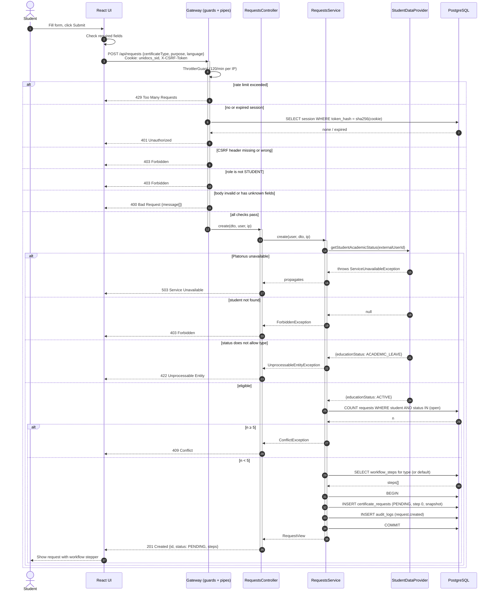
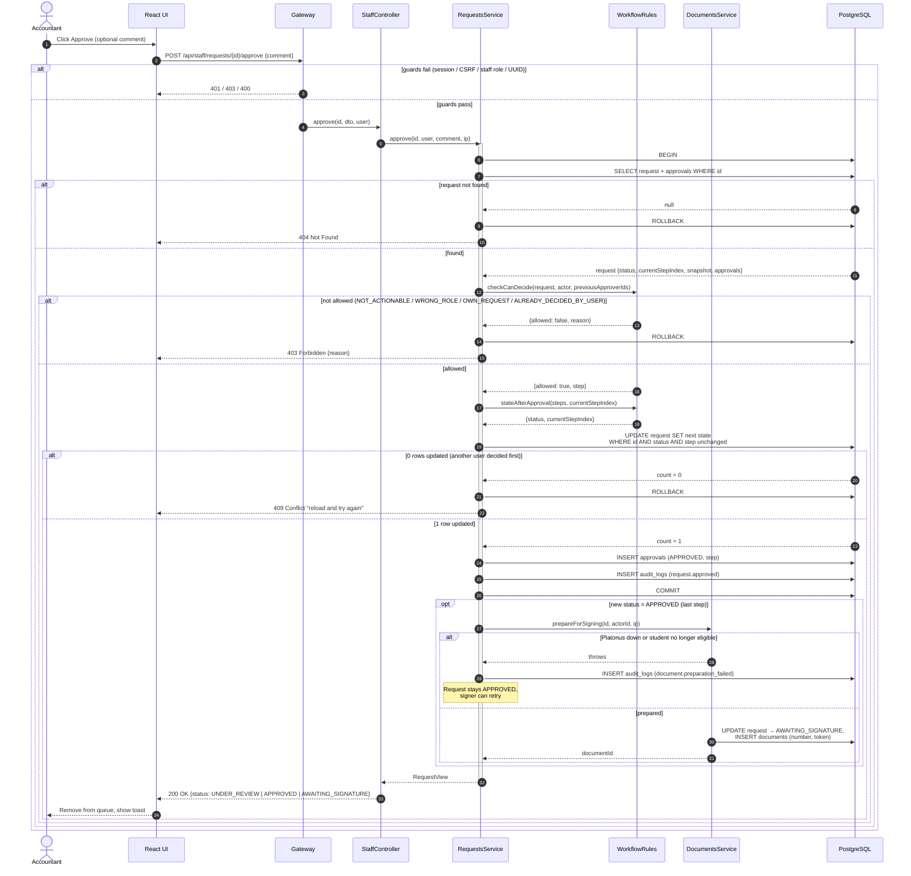
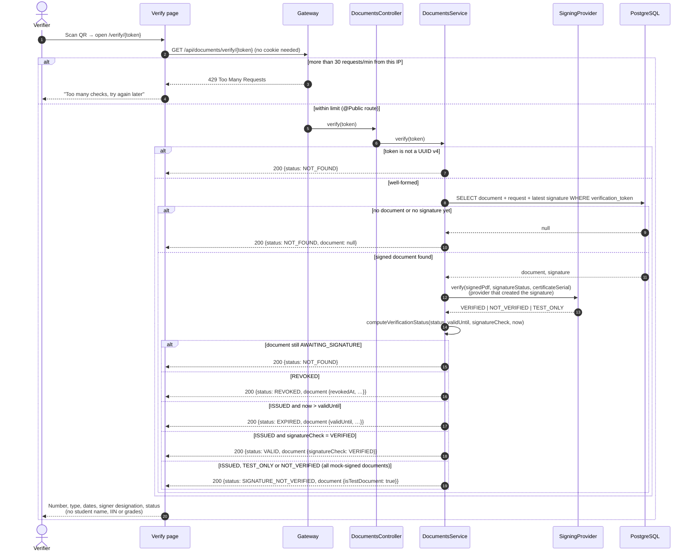

# UML Sequence Diagrams

Chronological HTTP messaging between the browser, the API layers and the database. Solid arrows are calls, dashed arrows are replies. `alt` / `else` frames are mutually exclusive error paths, `opt` frames run only when their guard holds. All three flows run through the same global guard chain; diagram 1 shows it in full, diagrams 2 and 3 collapse it.

Participants:

| Participant | Code |
| --- | --- |
| UI | React page in `apps/web` + `api` client |
| Gateway | Helmet, `ThrottlerGuard`, `SessionGuard`, `CsrfGuard`, `RolesGuard`, `ValidationPipe` |
| Controller | `RequestsController`, `StaffController`, `DocumentsController` |
| Service | `RequestsService`, `DocumentsService` |
| Platonus | `StudentDataProvider` |
| DB | PostgreSQL via Prisma |

## 1. `POST /api/requests` — submit a request

Use case UC-02. Requirements FR-AUTH-07/08, FR-REQ-01 … FR-REQ-06.

## 2. `POST /api/staff/requests/:id/approve` — approve a step

Use case UC-05. Requirements FR-WF-02 … FR-WF-06, FR-DOC-01, FR-DOC-02.

## 3. `GET /api/documents/verify/:token` — public verification

Use case UC-07. Requirements FR-VER-01 … FR-VER-05.

