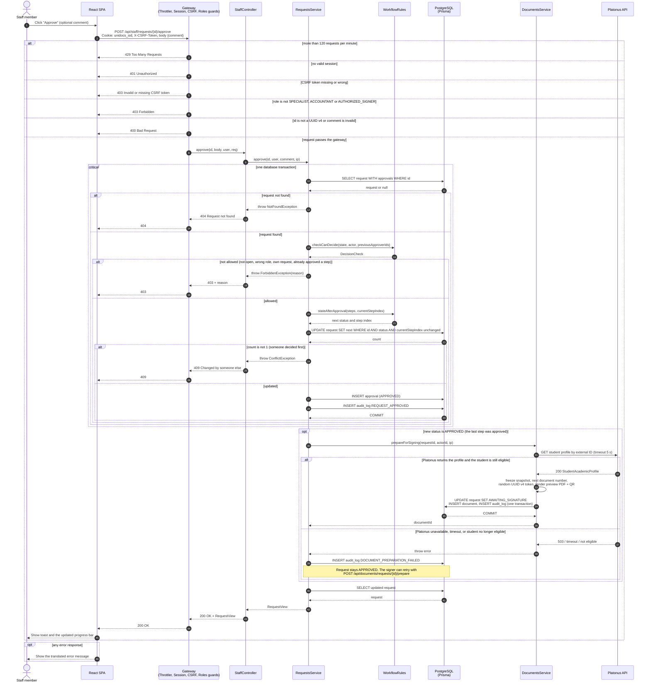
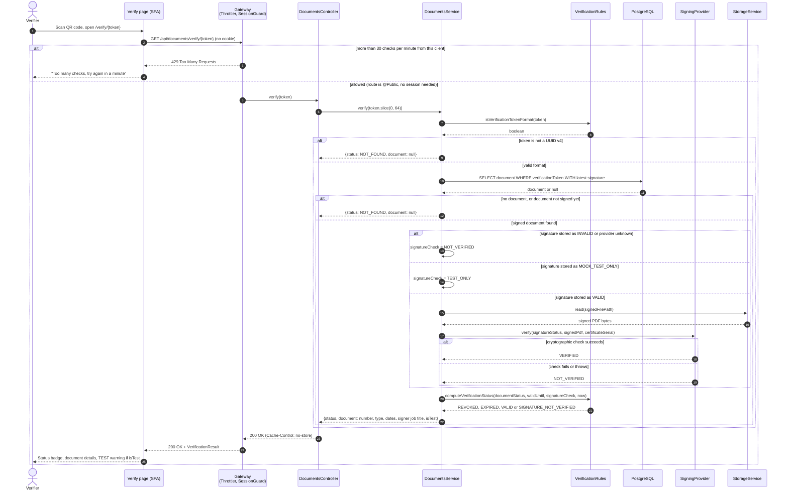

# UML Sequence Diagrams — UniDocs

Messages are in chronological order from top to bottom. Solid arrows (`->>`) are calls or HTTP requests, dashed arrows (`-->>`) are responses. `alt` / `else` frames show the success path and every error path with its HTTP status. `opt` frames show optional steps. `critical` marks a database transaction.

Participants map to classes in the [class diagram](class-diagram.md).

## 1. Approve the current workflow step

Use cases: [UC-06](../behavioral/use-case-diagram.md#uc-06-approve-workflow-step) and, when the last step is approved, [UC-08](../behavioral/use-case-diagram.md#uc-08-prepare-document). Requirements: FR-AUTH-05…07, FR-WF-02, FR-WF-04, FR-WF-05, FR-DOC-01, FR-DOC-02.

What this shows:

- **Gateway errors** (`429`, `401`, `403`, `400`) are returned before any business code runs.
- **Business errors** (`404`, `403`, `409`) are raised inside the transaction, so nothing is written when they happen.
- **A Platonus failure does not fail the approval.** The approval is already committed and the response is still `200`. Only document preparation is postponed (NFR-AVL-04).

## 2. Public QR verification

Use case: [UC-11](../behavioral/use-case-diagram.md#uc-11-verify-certificate). Requirements: FR-VER-01…05.

What this shows:

- The endpoint **always answers `200`** with a status, except for rate limiting. An unknown token is a normal `NOT_FOUND` result, not an HTTP error, so probing tokens gives no extra information.
- The order of the checks in `computeVerificationStatus` gives the precedence **revoked → expired → signature** (FR-VER-02).
- The response contains **no student personal data** (FR-VER-03).
