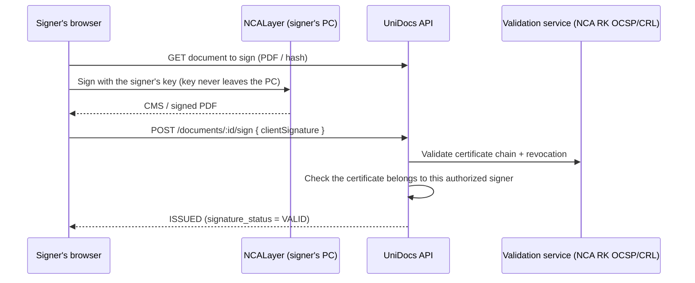

# Electronic digital signature

## Current state

Only the **mock** signing provider is implemented. It does **not** create any cryptographic signature. Documents it "signs":

- carry a diagonal **TEST / NOT LEGALLY SIGNED** watermark and a red footer in Kazakh/Russian/English;
- are stored with `signature_status = MOCK_TEST_ONLY` and `documents.is_test = true`;
- show *"Test document — not officially verified"* and status `SIGNATURE_NOT_VERIFIED` on the public verification page — never "Signature verified".

The API refuses to start with `SIGNING_PROVIDER=mock` when `NODE_ENV=production`, and the signing service additionally refuses to issue a document in production unless the provider returns a `VALID` signature.

## Interface

`apps/api/src/signing/signing-provider.types.ts`

```ts
interface SigningProvider {
  name: string;
  legallyValid: boolean;
  pdfMode: "TEST_SIGNED" | "OFFICIAL";
  sign(input: { pdf, signer, clientSignature }): Promise<SignResult>;
  verify(input: { signedPdf, signatureStatus, certificateSerial }): Promise<"VERIFIED" | "NOT_VERIFIED" | "TEST_ONLY">;
}
```

Existing signatures are always verified by the provider that created them (`document_signatures.provider`).

## Target design for Kazakhstan (NCALayer / NCA RK)

`OfficialSigningProvider` is a placeholder that throws until implemented and never reports `VERIFIED`. No government API is assumed or simulated. The intended design, to be confirmed with AHEU's IT and legal departments:



Requirements:

- **Private keys and their passwords never reach the server.** Signing happens on the signer's computer through NCALayer.
- The server validates the signature, the certificate chain to NCA RK, revocation status (OCSP/CRL), validity period and that the certificate subject (IIN/BIN) matches the authorized signer and AHEU.
- Store the signed artifact, certificate serial and validation details in `document_signatures`.
- Only then mark the document `ISSUED` with `signature_status = VALID`; the verification page then shows "Signature verified" after re-validating.

## Steps to enable

1. Agree on the signature format (CMS detached vs. PAdES) and validation service with AHEU IT.
2. Add the NCALayer client to the signer dashboard (the API already accepts `clientSignature`).
3. Implement `OfficialSigningProvider.sign()` / `verify()` and change `pdfMode` rendering as needed.
4. Record signers' certificate identifiers in their user profile and check them on signing.
5. Test with NCA RK test certificates, then set `SIGNING_PROVIDER=official`.

Do not claim eGov or government verification unless such an integration has actually been implemented and approved.
