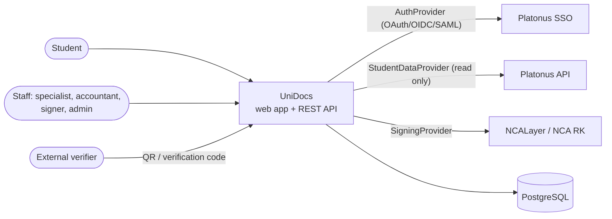

# UniDocs — System Requirements Specification (SRS)

| | |
| --- | --- |
| Product | UniDocs — AHEU certificate management system |
| Version | 1.0 (Assignment 3, PED 741) |
| Scope of this document | Problem and solution space, personas, functional and non-functional requirements |
| Related models | [UML diagrams](diagrams/README.md) · [Database ERD](database-erd.md) · [API](api-documentation.md) · [Architecture](architecture.md) |

The key words **shall** (mandatory), **should** (recommended) and **may** (optional) are used as in RFC 2119. Every functional requirement is written so that a test can pass or fail it; the *Verified by* column names the automated test or the inspection that checks it.

---

## 1. Problem space

### 1.1 Problem statement

Students of Almaty Humanitarian-Economic University (AHEU) regularly need official certificates for employers, internships, embassies, scholarship committees and banks. Today a certificate means:

1. visiting several offices (registrar, accounting, rector's office) in person, often during lectures;
2. waiting 2–5 working days with no way to see where the request is;
3. receiving a paper document that a third party cannot check without phoning the university, so forged certificates are hard to detect.

Staff, in turn, re-type student data that already exists in Platonus (the university's academic information system), and there is no record of who approved or signed what.

### 1.2 Stakeholders and their pains

| Stakeholder | Current pain | Measurable goal |
| --- | --- | --- |
| Student | Office visits, no status visibility | Request in < 3 minutes from any device; status visible at every step |
| Registrar specialist / accountant | Manual data entry, paper queues | Data read live from Platonus; one queue showing only their own step |
| Authorized signer | Signs paper copies without context | Signs from a queue with the approval history attached |
| System administrator | No control over who may approve | Configurable roles and approval chain, full audit log |
| External verifier (employer, embassy) | Cannot verify authenticity | Verifies a certificate in < 10 seconds by QR code, without an account |

### 1.3 Problem / solution boundary

| In scope (UniDocs solves it) | Out of scope (stays outside UniDocs) |
| --- | --- |
| Online certificate requests and status tracking | Storing or editing academic records (grades, enrollment) — **Platonus remains the source of truth** |
| Configurable multi-step approval workflow | Student authentication credentials — delegated to Platonus SSO, no student passwords |
| PDF generation with a unique QR verification token | Cryptographic key custody — private keys stay on the signer's PC (NCALayer) |
| Electronic signing through a pluggable signing provider | Issuing diplomas or transcripts with grades |
| Public verification page without personal data | Payment for certificates |
| Staff account and role administration, audit log | Automatic (AI) approval, signing or revocation — always an explicit human action |

### 1.4 External interfaces (system context)

In development all three external systems are replaced by mock providers that are clearly labelled as such (see [architecture.md](architecture.md#integration-boundaries)).

---

## 2. User personas

All personas are fictional.

| Persona | Role (system) | Profile | Goals | Frustrations | Key requirements |
| --- | --- | --- | --- | --- | --- |
| **Aruzhan, 20** | `STUDENT` | 3rd-year Economics student, works part-time, uses a phone for everything, prefers Kazakh | Get an enrollment certificate for a bank in one evening | Office hours overlap with lectures; no idea when the paper is ready | FR-REQ-01…08, FR-DOC-05, NFR-USE-01…03 |
| **Daniyar, 35** | `SPECIALIST` | Registrar's office, processes ~40 requests a day | See only requests waiting for him, with live Platonus data | Re-typing data, phone calls asking "is it ready?" | FR-WF-01…05 |
| **Gulnara, 42** | `ACCOUNTANT` | Checks tuition debts before a certificate is released | A queue of requests at the financial-check step | Requests reaching the signer before her check | FR-WF-02, FR-WF-03 |
| **Prof. Serik, 55** | `AUTHORIZED_SIGNER` | Vice-rector; signs on a desktop PC with an EDS key in NCALayer | Sign a batch quickly, knowing each was approved | Signing without seeing who approved | FR-DOC-01…04 |
| **Aigerim, 30** | `SYSTEM_ADMIN` | University IT department | Provision staff, adjust the approval chain, investigate incidents | No audit trail; staff sharing accounts | FR-ADM-01…07 |
| **Mark, 40** | none (public) | HR manager at an employer or an embassy officer, may not read Kazakh | Confirm a certificate is genuine and not revoked | Has to phone the university | FR-VER-01…05 |

---

## 3. Functional requirements

Priority: **M** = must (release 1.0), **S** = should.

### 3.1 Authentication and sessions (FR-AUTH)

| ID | Requirement | Pri. | Verified by |
| --- | --- | --- | --- |
| FR-AUTH-01 | The system **shall** authenticate students only through the configured `AuthProvider` (Platonus SSO in production) and **shall not** collect, store or proxy Platonus passwords. | M | Inspection of `auth/`; e2e "logs a student in through the mock Platonus flow" |
| FR-AUTH-02 | The system **shall** reject a login callback whose `state` parameter does not match the `state` cookie set at login, redirecting to the login page with `error=state` without creating a session. | M | e2e "rejects a forged login state" |
| FR-AUTH-03 | The system **shall** create a `STUDENT` account on first login only if the `StudentDataProvider` finds the student; otherwise it **shall** deny login. | M | `auth-providers.spec.ts` ("rejects unknown identities"); inspection of `auth.service.ts` |
| FR-AUTH-04 | The system **shall not** create staff accounts on login; a staff identity without a provisioned account **shall** be denied. | M | e2e "does not auto-create staff accounts" |
| FR-AUTH-05 | The system **shall** issue a 32-byte random session token in an `HttpOnly`, `SameSite=Lax` cookie and **shall** store only its SHA-256 hash. | M | e2e (cookie flags); inspection of `session.service.ts` |
| FR-AUTH-06 | The system **shall** expire a session after `SESSION_TTL_HOURS` (default 8 h, allowed 1–72 h) and **shall** delete it on logout. | M | e2e "…ends the session on logout" |
| FR-AUTH-07 | The system **shall** reject every `POST`, `PUT`, `PATCH` and `DELETE` request without a valid `X-CSRF-Token` header with HTTP 403. | M | e2e "requires a CSRF token…" |
| FR-AUTH-08 | The system **shall** return HTTP 401 for any non-public endpoint called without a valid session. | M | e2e "rejects anonymous access to private routes" |

### 3.2 Certificate requests (FR-REQ)

| ID | Requirement | Pri. | Verified by |
| --- | --- | --- | --- |
| FR-REQ-01 | The system **shall** allow a `STUDENT` to submit a request with a certificate type (6 types), a purpose (6 purposes), optional purpose details (≤ 200 characters) and a language (`KK`, `RU`, `EN`; default `KK`). | M | e2e "validates request input" |
| FR-REQ-02 | The system **shall** reject a request body with unknown fields or invalid values with HTTP 400. | M | e2e "validates request input" |
| FR-REQ-03 | The system **shall** read the student's education status live from the `StudentDataProvider` at submission and **shall** reject with HTTP 422 a certificate the status does not allow (`GRADUATION_CONFIRMATION` only for `GRADUATED`; all others only for `ACTIVE`). | M | e2e "refuses certificates the student's status does not allow" |
| FR-REQ-04 | The system **shall** reject with HTTP 409 a new request when the student already has 5 requests in progress (`PENDING`, `UNDER_REVIEW`, `APPROVED`, `AWAITING_SIGNATURE`). | M | Inspection of `requests.service.ts` |
| FR-REQ-05 | The system **shall** store a snapshot of the approval chain with each request at submission, so later configuration changes do not affect it. | M | Inspection of `requests.service.ts`; `workflow-rules.spec.ts` (snapshot parsing) |
| FR-REQ-06 | The system **shall** create every request with status `PENDING` and step index 0 and return HTTP 201. | M | e2e |
| FR-REQ-07 | The system **shall** show a student only their own requests and documents and **shall** answer HTTP 404 for another student's record. | M | e2e "keeps requests private to their owner (IDOR)" |
| FR-REQ-08 | The system **shall** display, for each request, its status, every workflow step and every decision with its comment (including the rejection reason). | M | `frontend.spec.tsx` ("marks the current/rejected step") |

### 3.3 Approval workflow (FR-WF)

| ID | Requirement | Pri. | Verified by |
| --- | --- | --- | --- |
| FR-WF-01 | The system **shall** show each staff member only requests whose current step requires one of their roles. | M | e2e "enforces the order and roles of the approval chain" |
| FR-WF-02 | The system **shall** allow only a user holding the role of the current step to approve or reject it, and **shall** answer HTTP 403 otherwise. | M | `workflow-rules.spec.ts`; e2e |
| FR-WF-03 | The system **shall not** allow one user to approve two steps of the same request (separation of duties), nor any user to decide their own request. | M | `workflow-rules.spec.ts` |
| FR-WF-04 | The system **shall** require a rejection reason of 3–1000 characters and **shall** set the request to `REJECTED`. | M | e2e |
| FR-WF-05 | The system **shall** apply a decision only if the request still has the status and step it had when it was read, and **shall** answer HTTP 409 to a concurrent second decision. | M | Inspection (`updateMany` guard + unique `(request_id, step_index)`) |
| FR-WF-06 | The system **shall** move a request to `UNDER_REVIEW` after a non-final approval and to `APPROVED` after the final one. | M | `workflow-rules.spec.ts` |
| FR-WF-07 | The system **shall** let a `SYSTEM_ADMIN` configure a default chain and per-type overrides of 1–6 steps, whose last step **shall** be `AUTHORIZED_SIGNER`. | M | e2e "validates workflow configuration" |

### 3.4 Document generation and signing (FR-DOC)

| ID | Requirement | Pri. | Verified by |
| --- | --- | --- | --- |
| FR-DOC-01 | When a request becomes `APPROVED`, the system **shall** generate a PDF in the requested language from live Platonus data, with a document number `AHEU-YYYY-NNNNNN` and a QR code, and set the request to `AWAITING_SIGNATURE`. | M | `certificate-pdf.spec.ts`; e2e |
| FR-DOC-02 | If preparation fails (e.g. Platonus unavailable), the system **shall** keep the request `APPROVED`, log the failure and let an `AUTHORIZED_SIGNER` or `SYSTEM_ADMIN` retry. | M | Inspection of `requests.service.ts` |
| FR-DOC-03 | The system **shall** give every document a random UUID v4 verification token that never changes and is unique. | M | e2e "gives every certificate its own unguessable token" |
| FR-DOC-04 | The system **shall** allow only an `AUTHORIZED_SIGNER` to sign a document in `AWAITING_SIGNATURE`; signing **shall** set the document and request to `ISSUED` and the validity to `CERTIFICATE_VALIDITY_DAYS` (default 90). A second signature attempt **shall** get HTTP 409. | M | e2e "issues, verifies and revokes…" |
| FR-DOC-05 | The system **shall** let the owning student download a document only when it is `ISSUED`. | M | e2e "lets the student list their issued documents" |
| FR-DOC-06 | Documents signed by the mock provider **shall** carry a "TEST / NOT LEGALLY SIGNED" watermark and **shall** never be reported as signature-verified. | M | `signing-providers.spec.ts`; `verification.spec.ts` |

### 3.5 Public verification (FR-VER)

| ID | Requirement | Pri. | Verified by |
| --- | --- | --- | --- |
| FR-VER-01 | The system **shall** provide a public page `/verify/:token` and endpoint `GET /api/documents/verify/:token` that need no login. | M | e2e |
| FR-VER-02 | The system **shall** return exactly one of `VALID`, `REVOKED`, `EXPIRED`, `NOT_FOUND`, `SIGNATURE_NOT_VERIFIED`, evaluated in that priority order. | M | `verification.spec.ts` |
| FR-VER-03 | The system **shall** return the same `NOT_FOUND` answer for malformed, unknown and not-yet-signed tokens. | M | `verification.spec.ts` |
| FR-VER-04 | The verification response **shall not** contain the student's name, IIN, Platonus ID, grades or internal IDs. | M | e2e; inspection |
| FR-VER-05 | The system **shall** limit verification to 30 requests per minute per IP and answer HTTP 429 above it. | M | e2e "limits the public verification endpoint" |

### 3.6 Administration and audit (FR-ADM)

| ID | Requirement | Pri. | Verified by |
| --- | --- | --- | --- |
| FR-ADM-01 | The system **shall** allow a `SYSTEM_ADMIN` to provision staff accounts with roles `SPECIALIST`, `ACCOUNTANT`, `AUTHORIZED_SIGNER` or `SYSTEM_ADMIN`. | M | e2e |
| FR-ADM-02 | The system **shall not** allow an administrator to change their own roles or status. | M | e2e "never lets an administrator change their own roles or status" |
| FR-ADM-03 | The system **shall not** grant staff roles to student accounts. | M | e2e "never gives staff roles to student accounts" |
| FR-ADM-04 | Deactivating a user **shall** delete all of their sessions immediately. | M | Inspection of `admin.service.ts` |
| FR-ADM-05 | The system **shall** allow a `SYSTEM_ADMIN` to revoke an `ISSUED` document with a reason of 5–500 characters; verification **shall** then return `REVOKED`. | M | e2e "issues, verifies and revokes…" |
| FR-ADM-06 | The system **shall** write an audit entry (actor, action, entity, IP, time) for every login, logout, request, decision, preparation, signature, download, revocation, role change and workflow change. | M | Inspection of `audit.service.ts` call sites |
| FR-ADM-07 | The system **shall** let a `SYSTEM_ADMIN` filter and page through the audit log, newest first. | S | Manual UI check |

---

## 4. Non-functional requirements

Each NFR has a measurable target. Values marked *(target)* are design targets to be confirmed by load testing on the production server; the others are enforced by code or configuration.

### 4.1 Performance (NFR-PERF)

| ID | Requirement | Metric / threshold |
| --- | --- | --- |
| NFR-PERF-01 | Read endpoints (`GET /requests/my`, `/staff/requests`, `/documents/my`) **shall** respond quickly under normal load. | p95 ≤ 500 ms with 50 concurrent users *(target)* |
| NFR-PERF-02 | Any page **shall** become interactive quickly on a mid-range phone over 4G. | ≤ 1.5 s *(target)* |
| NFR-PERF-03 | Signing a document (PDF render + store) **shall** finish quickly. | p95 ≤ 3 s, mock provider *(target)* |
| NFR-PERF-04 | Public verification **shall** be answered quickly. | p95 ≤ 300 ms *(target)* |
| NFR-PERF-05 | List endpoints **shall** be bounded. | Staff/admin lists ≤ 500 rows; users ≤ 200; audit log paged |

### 4.2 Availability and reliability (NFR-AVL)

| ID | Requirement | Metric / threshold |
| --- | --- | --- |
| NFR-AVL-01 | The service **shall** be available during the academic year. | ≥ 99.5 % monthly uptime (≈ 3.6 h downtime / month) *(target)* |
| NFR-AVL-02 | Data **shall** survive server loss. | Daily PostgreSQL + `STORAGE_DIR` backup; RPO ≤ 24 h, RTO ≤ 4 h *(target)* |
| NFR-AVL-03 | Platonus downtime **shall not** lose approved work. | Request stays `APPROVED`; preparation retried (FR-DOC-02) |
| NFR-AVL-04 | Concurrent decisions **shall not** corrupt the workflow. | 0 double-approvals: guarded update + unique `(request_id, step_index)` |

### 4.3 Security and privacy (NFR-SEC)

| ID | Requirement | Metric / threshold |
| --- | --- | --- |
| NFR-SEC-01 | Authorization **shall** be enforced on the backend for every endpoint. | Global guard chain: rate limit → session → CSRF → roles; ownership in services |
| NFR-SEC-02 | Access to other users' records **shall not** leak existence. | HTTP 404 (not 403) for foreign IDs |
| NFR-SEC-03 | Brute force **shall** be limited. | 120 req/min per IP & route; login 20/min; verification 30/min |
| NFR-SEC-04 | Verification tokens **shall** be unguessable. | UUID v4, 122 random bits |
| NFR-SEC-05 | Traffic **shall** be encrypted in production. | HTTPS only; `COOKIE_SECURE=true`; `VERIFICATION_BASE_URL` must be `https://` or the API refuses to start |
| NFR-SEC-06 | Unsafe configurations **shall** be refused in production. | API does not start with any `mock` provider when `NODE_ENV=production` |
| NFR-SEC-07 | Secrets **shall not** be in the repository. | `.env` git-ignored; only `.env.example` committed |
| NFR-SEC-08 | Responses with personal data **shall not** be cached. | `Cache-Control: no-store`; Helmet security headers |
| NFR-SEC-09 | Private signing keys **shall never** reach the server. | Signing happens client-side through NCALayer |
| NFR-SEC-10 | Personal data **shall** be minimised. | Academic data not stored, only the frozen snapshot inside an issued document |

### 4.4 Usability and accessibility (NFR-USE)

| ID | Requirement | Metric / threshold |
| --- | --- | --- |
| NFR-USE-01 | The UI **shall** be available in Kazakh, Russian and English. | 100 % of UI strings in `kk`, `ru`, `en` message files (checked by translation test) |
| NFR-USE-02 | The UI **shall** be responsive. | Usable from 360 px to 1920 px width without horizontal scrolling |
| NFR-USE-03 | A first-time student **shall** submit a request quickly. | ≤ 3 minutes, ≤ 4 form fields |
| NFR-USE-04 | The UI **should** meet accessibility guidelines. | WCAG 2.1 AA: keyboard navigation, labelled inputs, contrast ≥ 4.5:1 |

### 4.5 Maintainability (NFR-MNT)

| ID | Requirement | Metric / threshold |
| --- | --- | --- |
| NFR-MNT-01 | Code **shall** be type-safe. | TypeScript `strict`; 0 explicit `any`; 0 `tsc` errors |
| NFR-MNT-02 | Code **shall** pass linting. | 0 ESLint errors in CI |
| NFR-MNT-03 | Business rules **shall** be tested. | Unit + e2e tests pass; line coverage ≥ 80 % for `workflow/` and `documents/` *(target)* |
| NFR-MNT-04 | External systems **shall** be replaceable. | Behind `AuthProvider`, `StudentDataProvider`, `SigningProvider` interfaces |
| NFR-MNT-05 | Commits **shall** follow Conventional Commits. | 100 % of commits on `main` |

---

## 5. Constraints and assumptions

- **Technology** (from [agents.md](../agents.md)): React 19, TypeScript, Vite, Tailwind CSS; Node.js REST API (NestJS on Express); PostgreSQL with Prisma.
- **Legal**: a certificate is legally valid only with a qualified electronic signature (NCA RK). Until the official signing provider is implemented, every issued document is a test document (FR-DOC-06).
- **Assumption**: AHEU will provide Platonus SSO and API documentation; the official providers are placeholders until then.
- **AI**: AI tools may help develop the system but **shall not** approve, sign, issue or revoke documents or change academic records.

---

## 6. Traceability

| Requirement group | Use cases | Diagrams |
| --- | --- | --- |
| FR-AUTH | UC-01 | [State machine: session](diagrams/behavioral/state-machine-diagram.md#3-session-lifecycle) |
| FR-REQ | UC-02, UC-03 | [Activity](diagrams/behavioral/activity-diagram.md#1-submit-a-certificate-request), [Sequence 1](diagrams/structural/sequence-diagram.md#1-post-apirequests--submit-a-request) |
| FR-WF | UC-05, UC-09 | [Activity 2](diagrams/behavioral/activity-diagram.md#2-approve-sign-and-issue), [Sequence 2](diagrams/structural/sequence-diagram.md#2-post-apistaffrequestsidapprove--approve-a-step), [State machine: request](diagrams/behavioral/state-machine-diagram.md#1-certificaterequest-lifecycle) |
| FR-DOC | UC-04, UC-06 | [State machine: document](diagrams/behavioral/state-machine-diagram.md#2-document-lifecycle), [Class diagram](diagrams/structural/class-diagram.md) |
| FR-VER | UC-07 | [Sequence 3](diagrams/structural/sequence-diagram.md#3-get-apidocumentsverifytoken--public-verification) |
| FR-ADM | UC-08, UC-09, UC-10 | [Use case diagram](diagrams/behavioral/use-case-diagram.md) |
